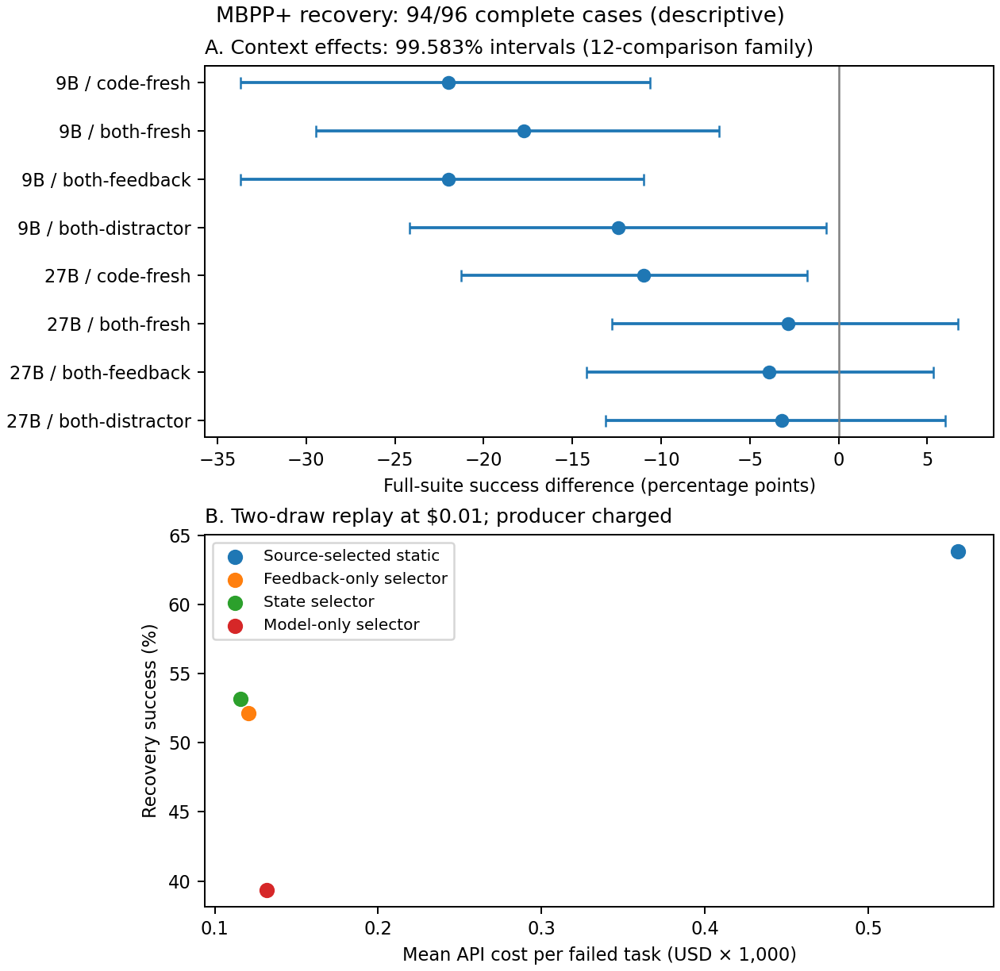

# How to Pick a Model

**After a failed attempt, should an agent reuse its work or start again?**

We study whether code and verifier feedback from a failed attempt help the next
attempt, and whether that benefit can be predicted before paying for it. The
longer-term goal is cost-aware continue/restart/switch/stop decisions for agents.

**In development:** the [Python repair environment](experiments/python-repair/checkpoint-environment/README.md)
saves failed patches, restores checkpoints and prepares matched continue/restart
requests. Its runnable offline demo uses handwritten fixtures; it contains no
new model results or live collector.

**Latest result:** [four feedback-only policies on 157 new BigCodeBench tasks](experiments/bigcodebench/feedback-only-routing/results/fixed-policies-20261022/report.md).
Immediate 9B → 27B escalation solves **98/157** tasks versus **102/157** for
repeated 9B: **−2.55 percentage points**, paired 95% interval **[−7.01, +1.27]**.
The primary gate fails; no new selector is trained. Mean API spend is lower,
but conservative admission often stops 27B with most of its budget unused;
this does not establish equal-quality savings. All **628/628** policy outcomes
and **1,492** responses are retained, with $0.38896675 collection charges and
no unresolved reservations. Read the [research note](docs/blog/feedback-only-escalation.md)
for the admission and public-test limitations. This is not a test of feedback
against no feedback.


This repository retains the HumanEval+, MBPP+ and BigCodeBench evidence needed
to study that question: verified trajectories, retry-allocation baselines,
context/routing experiments, cost accounting, and reproducible figures.

**Earlier, separate result:** the [external MBPP+ replication](experiments/mbpp-plus/context-value-transfer/results/replication-20261022/README.md)
contains **2,878 recovery responses and 288 API forecasts**. On its 94 complete
failed tasks, 9B recovery succeeds 52.8% with feedback alone versus 30.9% when
failed code is added; the 27B rates are 62.4% and 58.5%. Two solver responses
remain censored: complete-case comparisons are descriptive, with all 96 selected
failures retained in missing-state bounds. The primary selector advantage over
feedback-only remains unproven. Read the [report](experiments/mbpp-plus/context-value-transfer/results/replication-20261022/report.md),
[paper draft](docs/paper/recovery-value/README.md), or [blog](docs/blog/when-to-keep-failed-code.md).

The [earlier HumanEval+ study](experiments/humaneval-plus/context-value/results/validation-20261022/report.md)
trained on Gemma failures and evaluated on Ministral failures
after Gemma's upstream pool became unavailable. This is a declared transfer test;
the original same-producer validation is not complete. Simple one-checkpoint
selectors and replay are implemented. A general multi-step controller remains
future work. All 51 observed HumanEval+ failures are training data for MBPP+;
they are not counted again as a fresh holdout. Historical traces cannot score
an unobserved handoff.



Start with the [decision protocol](docs/decision-protocol.md), the
[experiment index](experiments/README.md), and the
[reproduction guide](docs/reproducibility.md).

## What is retained

- **HumanEval+:** model-size frontier, retry allocation, strategy routing,
  and held-out router-context search.
- **MBPP+:** frozen cross-benchmark recovery evaluation with feedback-only,
  artifact-aware, static and API forecasting controls.
- **BigCodeBench:** complete fixed-policy feedback-only trajectories, receipt and
  prompt audits, prespecified paired comparisons and offline verifier repeat.
- **Runtime:** budgeted model calls, isolated public verification, frozen
  policies, receipt/prompt audits and reproducible saved-data analysis.
- **Manuscripts:** the two existing sources, consolidated theory, and a separate
  empirical recovery draft built from the audited data.

## Quick start

Recompute the audited results from recorded outputs, without credentials, model
calls, candidate execution or GPUs:

```bash
uv sync --dev --frozen
uv run python scripts/verify_feedback_evidence.py \
  --input experiments/bigcodebench/feedback-only-routing/results/fixed-policies-20261022
```

This verifies all published checksums, frozen sources, receipt/prompt chains,
final statistics, diagnostic accounting and preservation of the single disclosed
interim snapshot. The API collection is finished; this command makes no calls.
The separately funded MBPP+ report can also be reproduced:

```bash
uv run python scripts/analyze_recovery_transfer.py \
  --input experiments/mbpp-plus/context-value-transfer/results/replication-20261022 \
  --forecasts experiments/mbpp-plus/context-value-transfer/results/replication-20261022/semantic-control \
  --expected-analysis experiments/mbpp-plus/context-value-transfer/results/replication-20261022/analysis.json \
  --output runs/mbpp-reanalysis
```

Use a fresh output directory. Current experiments require no Git LFS archives
or historical checkout for saved-data analysis.
The saved data include forecasts, frozen weights, task-level replays, receipts,
and every unresolved admission held at its full reservation. The cumulative
amount, including earlier studies and every reservation, is **$1.39600335**, below
the same $2 cap. See [the reproduction guide](docs/reproducibility.md) for the
earlier HumanEval+ replay and the separate paper build.

Run the offline repository checks:

```bash
uv sync --dev --frozen
uv run python scripts/maintenance/workflow.py check
```

Live runs require explicit model/compute setup. Optional environments and safe
commands are documented in [reproducibility](docs/reproducibility.md).

## Repository map

| Path | Role |
| --- | --- |
| `experiments/` | Seven evidence bundles and an offline Python repair environment |
| `src/vao/` | Task collectors, accounting, isolated verification and recorded-run primitives |
| `src/vao/humaneval/` | HumanEval+ workers, traces, retries and routing |
| `src/vao/analysis/` | Saved-evidence audits, reports and figure generation |
| `scripts/` | Experiment entrypoints, grouped maintenance and cluster setup |
| `tests/` | Analysis, collector, HumanEval+, repository and shared-unit checks |
| `docs/` | Research guides, manuscripts in `docs/paper/`, engineering and source maps |

## Evidence limits

HumanEval+ retains worker logs for 164 tasks per model. These results describe their recorded protocols; changing actions or
passing context between models requires new measurements.

The existing manuscripts are research background. Their four-term accounting
is conditional on its stated assumptions. The historical submitted-PDF issues
remain documented in the [reproducibility audit](docs/audits/manuscript-reproducibility.md).

The scope reduction and recoverable Git snapshots are recorded in
[repository history](docs/history-merge.md) and the
[branch review](docs/audits/branch-consolidation.md). The
[runtime architecture](docs/engineering/architecture.md) describes the maintained
package boundaries; the [layout guide](docs/engineering/layout.md) explains file
placement and stable commands. The
[development guide](docs/engineering/development.md) describes safe maintenance.

CIFAR-10 experiments, data and their dedicated launchers are retired from the
maintained tree; see [provenance](docs/history-merge.md). Historical manuscripts
retain their embedded figures for compilation.
