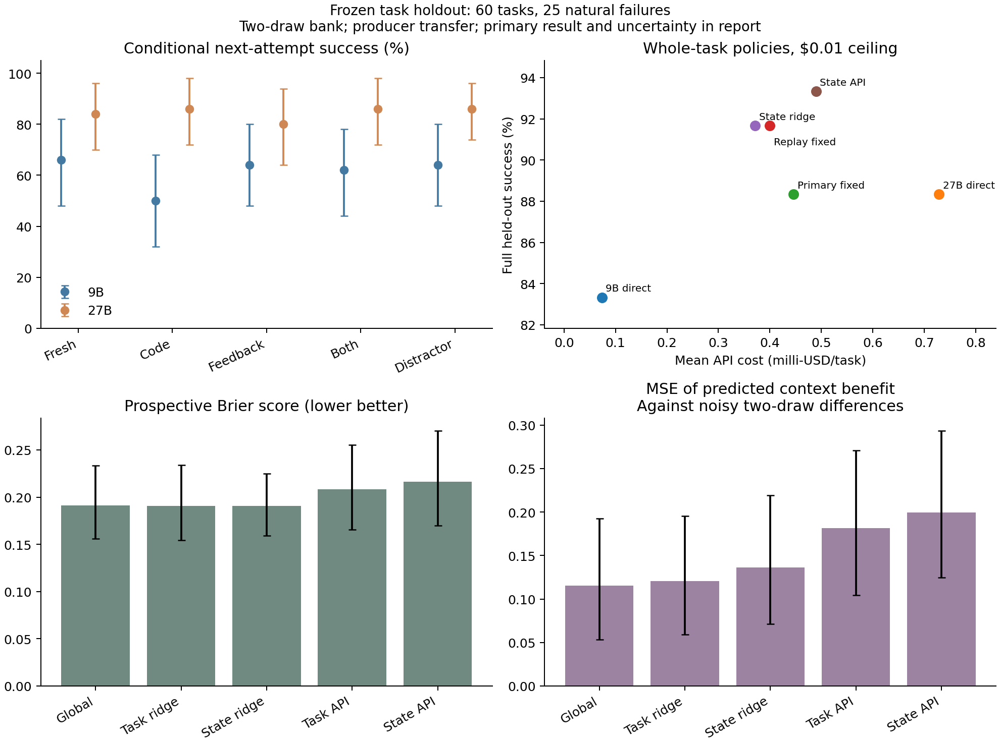

# After a coding agent fails, should it keep its work?

An agent has written a program and the tests fail. Its next attempt could start
again, revise the failed program, inspect the test feedback, or give both to a
stronger model. Each option spends money. Keeping the code might save useful
work, but it might also preserve the mistake.

We built a small experiment to separate two questions: **does failed work help,
and can an agent predict when it will help before paying for another attempt?**
The distinction matters. An average benefit from repair does not imply that a
selector can identify the right repair opportunities. A predictor can improve
its overall accuracy while ranking the available actions poorly.

Status: research blog draft, 2026-10-22. [Audited data and full report](../../experiments/humaneval-plus/context-value/results/validation-20261022/report.md); [frozen protocol and amendments](../../experiments/humaneval-plus/context-value/VALIDATION.md).

## External MBPP+ replication

The [new audited bank](../../experiments/mbpp-plus/context-value-transfer/results/replication-20261022/README.md)
adds a different benchmark and the missing feedback-only prediction control.
All 51 previously observed HumanEval+ failures become training data; none are
reused as new evaluation. The models, prompts, weights and main comparison were
fixed before target recovery. A [separate paper draft](../../paper/recovery-value/README.md)
contains methods, full comparisons and standard diagnostic identities.

We recorded **2,878 recovery responses and 288 valid API forecasts**. Two solver
responses have no preserved identity, so 94 of the 96 selected failures have
all 30 observations. They were never retried. After a disclosed partial audit,
the user authorized only requests that had never been admitted; two continuations
preserve their exact allowlists and source journals. The resulting complete-case
intervals are **descriptive**, including those adjusted for twelve comparisons.
All 96 selected states remain in missing-state utility bounds.

| Next-attempt context | Qwen3.5 9B | Qwen3.5 27B |
| --- | --- | --- |
| Fresh | 48.6% | 61.3% |
| Code | 26.6% | 50.4% |
| Feedback | 52.8% | 62.4% |
| Code + feedback | 30.9% | 58.5% |
| Unrelated package | 43.3% | 61.7% |

Each rate uses three draws on the same 94 complete failed tasks. Adding code to
feedback changes success by **−22.0 points for 9B** and **−3.9 for 27B**. The
direct difference between these effects is **−18.1 points**, nominal
family-adjusted interval **[−31.6, −5.3]**. Code alone also hurts the larger model
relative to fresh generation; model size does not supply a universal reuse rule.
The irrelevant control matches characters, not tokens, so this does not identify
an internal anchoring mechanism.

The fixed primary asks whether adding artifact features improves a selector
beyond public feedback. Its mean utility difference is **+$0.00011119 per
failure**, descriptive 95% interval **[−$0.00042595, +$0.00064848]**. The all-96
missing-state bounds also span zero. State and feedback policies solve 50/94
and 49/94; a source-selected static rule solves 60/94. Lower state-policy cost
does not establish the same reliability or a better utility tradeoff.

The prespecified API forecaster also does not establish a code-information
gain. Its state-minus-feedback utility interval spans zero; state Brier is
0.3294 versus feedback-only's 0.2920. The full-state forecast fee averages
$0.00011077, about **2.05 times a fresh 9B draw**, before paying for the chosen
solver. Forecast prompts were fixed before recovery, but forecast responses were
collected afterwards; this is an outcome-blind control, not physically
prospective prediction.

Exploratory noise-adjusted diagnostics suggest context benefits vary across
states under independent-draw assumptions. That leaves a prediction problem
worth studying; failure of these structural and zero-shot baselines does not
prove the value intrinsically unpredictable. Future tuning needs fresh tasks.
The cumulative known charges and all reservations are **$1.39600335 of $2**.
Collection is finished. The [result README](../../experiments/mbpp-plus/context-value-transfer/results/replication-20261022/README.md)
gives offline reproduction and accounting.

## Earlier HumanEval+ producer-transfer study

The remaining sections describe that earlier protocol and its original results.
Its former evaluation failures are now explicitly training data for MBPP+.

We collected **1,353 model responses**, including 1,020 matched recovery draws
across 51 naturally failed tasks: 26 development failures and 25 evaluation
failures. The result is useful evidence for a blog, with a limited conclusion:
**failed code can hurt the next solver; a reliable advantage from predicting
which context to keep remains unproven.** This is a Gemma-to-Ministral producer
transfer test with finite policy replay, not completion of the original
same-producer validation or a deployed multi-step agent comparison.



Error bars resample tasks, not individual calls. “Primary fixed” is selected by
development per-draw utility; “Replay fixed” uses the complete development policy
rollout. The report gives paired intervals and all secondary comparisons.

## Failed code was not uniformly useful

On the 25 evaluation failures, each cell below contains two draws per task.
Success requires both base and Plus tests, not merely fixing the visible example.

| Next-attempt context | Qwen3.5 9B | Qwen3.5 27B |
| --- | --- | --- |
| Fresh | 66% | 84% |
| Code | 50% | 86% |
| Feedback | 64% | 80% |
| Code + feedback | 62% | 86% |
| Unrelated package | 64% | 86% |

The 9B code-only difference from fresh is **−16 percentage points**, with a
task-bootstrap 95% interval of **[−30, −4] points**. This is an exploratory,
unadjusted comparison among several contrasts, not a universal discard rule.
For 27B, code plus feedback improves the point estimate by only 2 points over
fresh, and matches the unrelated package's 86%. Its paired difference from the
distractor is 0 points, interval [−6, +6]. This control supplies no clear evidence
that the relevant package's semantics improved aggregate recovery here.

Two post-hoc illustrations show why a universal reuse rule is risky:

| Task, next solver 9B | Fresh | Code | Feedback | Both |
| --- | --- | --- | --- | --- |
| HumanEval/101, splitting words | 2/2 | 0/2 | 2/2 | 2/2 |
| HumanEval/141, checking file names | 2/2 | 0/2 | 2/2 | 0/2 |

The failed word splitter returned an empty-string element for an empty input;
the failed filename checker used an incorrect regular expression. In these
realized draws, feedback alone recovered both cases, while passing the program
hurt. These examples were selected after seeing the results; each has only two
draws and does not identify the model's internal mechanism.

## A selector must beat a strong static rule

The primary comparison uses $0.01 per task and values a fully correct solution
at $0.01. Costs below are **milli-USD per task**; 1 milli-USD is $0.001.

| Whole-task policy | Fully correct | Mean API cost, milli-USD |
| --- | --- | --- |
| Direct 9B | 50/60 | 0.074 |
| Direct 27B | 53/60 | 0.728 |
| Primary fixed: 27B + feedback | 53/60 | 0.446 |
| Replay-selected fixed: 27B fresh | 55/60 | 0.400 |
| State ridge | 55/60 | 0.372 |
| Task API | 55/60 | 0.487 |
| State API | 56/60 | 0.490 |
| State model-only; always keep code + feedback | 56/60 | 0.436 |
| Fixed 27B + code (retrospective diagnostic) | 56/60 | 0.341 |

The state selector solves **55/60**, versus 53/60 for the original fixed rule.
Its primary net-utility gain is **+0.408 milli-USD per task**, 95% interval
**[+0.035, +0.952]**. That comparison is positive under the declared value and
admission rule.

The stronger replay-selected static control also solves **55/60**. Against it,
the state selector's gain shrinks to **+0.029 milli-USD**, interval
**[−0.461, +0.540]**. We have not demonstrated a reliable gain over that control.
Both static selections used development data only and were specified before
evaluation responses; the stronger control was not chosen after seeing the test.

The model-only ablation reaches 56/60 while always passing code and feedback.
Joint model/context selection does not beat that simpler control in this bank.
The fixed 27B-code row is a **retrospective diagnostic**, not a development-chosen
baseline: its good realized result must not be sold as an independently selected
strategy. All fixed-action replays are available in the saved analysis.

There is also a verifier limit: 35 initial solutions pass public tests, but one
fails Plus. A deployed policy stops on that public success and cannot use the
hidden outcome to rescue it. The same stopping rule applies to every child.

## Predicting success did not establish prediction of context value

| Predictor | Brier, lower better | MSE of observed context benefit, lower better |
| --- | --- | --- |
| Development priors | 0.19103 | 0.11559 |
| Task ridge | 0.19060 | 0.12065 |
| State ridge | 0.19053 | 0.13616 |
| Task API | 0.20820 | 0.18177 |
| State API | 0.21635 | 0.19931 |

State ridge and task ridge have almost identical Brier scores. The paired
state-minus-task Brier interval spans −0.02276 to +0.02341. State ridge's point
estimate of benefit MSE is worse than the task baseline and unconditional priors.
The API state view is also worse than its task-only view on both point metrics;
their paired intervals include zero. None of this demonstrates reliable benefit
prediction. Benefit MSE compares against noisy two-draw differences, not true
individual treatment effects.

All 50 API forecasts parse correctly, so malformed-output fallback does not
explain these results. A state forecast costs 0.122 milli-USD on average, about
1.7 times a fresh 9B attempt, before the selected attempt. The local ridge
predictor takes about 0.17 ms of CPU per prediction in an offline Darwin/arm64
microbenchmark; that is not end-to-end deployment latency or a dollar estimate.

## Collection cost and remaining uncertainty

Known charges are **$0.4836466** for this study and **$0.0230224** for the previous
discovery. Six admissions without preserved response identities retain their
full **$0.0082944** reservation: the conservative cumulative amount is
**$0.5149634**, below the approved $2 ceiling. Seven explicit empty provider
errors have policy-backed zero charges under OpenRouter's
[published insurance](https://openrouter.ai/blog/announcements/never-pay-for-empty-ai-responses-again/);
they remain failed draws, with raw usage and billing provenance retained.

The unrelated fields match character lengths, not tokenizer lengths. For 9B,
the relevant code+feedback prompt averages 572 input tokens versus 538 for the
distractor. For 27B, the corresponding means are 574 versus 538; the relevant
mean has 49 token receipts because one empty provider error has unknown tokens.
This is an imperfect relevance control, and the difference is not hidden.

The raw records, frozen weights, prospective forecasts, costs, transport stops,
reference audit, task-level rollouts and vector figure are checked in. The
internal audit reconstructs prompts, refits development weights, checks the
freeze boundary and accounts for every known receipt and unknown reservation.

## Reproduce the saved-data analysis

```bash
GIT_LFS_SKIP_SMUDGE=1 git clone https://github.com/EmaRimoldi/how-to-pick-a-model.git
cd how-to-pick-a-model
uv sync --dev --frozen
uv run python scripts/analyze_recovery_validation.py \
  --input experiments/humaneval-plus/context-value/results/validation-20261022 \
  --output runs/recovery-reanalysis
```

Use a fresh output directory. This reads recorded outputs; it makes no model
calls and executes no candidate code. It needs no credentials, GPU, optional
EvalPlus installation or historical LFS archives. Statistical estimates are
deterministic for the saved data; CPU timings and figure metadata can vary.

## What the experiment measures

We use HumanEval+ with the pinned EvalPlus 0.3.1 evaluator. Gemma 3 4B IT produces
the development solutions. Ministral 3B 2512 produces the evaluation solutions;
the reason for this explicit protocol amendment is described below. Only failure on the public base
tests triggers recovery. The additional Plus tests measure final correctness;
their inputs and results never enter a model prompt, a feature, or an action
selection rule. Public feedback can reveal a failing base input and an acceptable
output, so this is a deliberately informative verifier regime.

For each natural failed program, Qwen3.5 9B and 27B receive the same task under
five conditions: fresh task, failed code, public feedback, code plus feedback,
and unrelated code plus feedback from a different development task. Each
model/condition gets two draws from the same original checkpoint. There are no
injected bugs and no discarded malformed or failed provider responses.

The unrelated package matches the relevant package's character lengths. It is
**not token matched**; we publish the provider token counts. Truncation and
padding also make this an imperfect control for semantic relevance. It helps
diagnose irrelevant context, but does not cleanly isolate every effect of
prompt length or presentation.

We froze 83 development tasks and 60 evaluation tasks, leaving 19 tasks in
reserve. Two tasks were excluded before live calls: one has a contradictory
public example, and the other fails even with its canonical solution under the
pinned checker. All remaining reference programs passed the preflight. The
development set contains the earlier pilot/discovery tasks; the evaluation set
had no prior model calls in this campaign. This is a task holdout, not a guarantee
that models never saw HumanEval during pretraining.

### A serving failure changed the evaluation population

After completing development and freezing the policy, DeepInfra rejected the
first evaluation admissions with HTTP 429. A serial probe identified an upstream
shared-pool limit; a separately pinned Parasail endpoint for the same Gemma model
returned the same limit. No evaluation solution or outcome was observed through
either endpoint. We preserved all six requests without a response identity and
held their entire $0.0082944 worst-case reservation. They are not zero-cost
receipts, failed code samples, or observations we silently retried away.

Before any evaluation response, we declared one final producer substitution:
Ministral 3B 2512 through the `mistral` endpoint, whose precision is undisclosed.
The same 60 task IDs, development data, exact frozen weights, priors and decision
rule were retained. Initial evaluation calls run serially; recovery calls use
four bounded workers. We did not search model outcomes for a favorable result.

The original same-producer Gemma validation is therefore **not complete**. The
results below are a **cross-producer transfer test**, from Gemma failures to
Ministral failures. That distribution change is a limitation, not a detail to
hide in a footnote. The complete observed bank supports its stated replay;
deployment-level outage/retry costs are not fully identified. The known charges
plus every unresolved reservation stay inside the approved campaign budget.

## What the selector knows

The cheap learned baseline uses fixed ridge regression, not another large model.
It predicts each model/context action's probability of passing the full suite.
The task baseline sees prompt length. The state baseline additionally sees
program size, AST size, syntax validity, public failure fraction, and error
indicators. Feature definitions, smoothing and regularization were fixed before
evaluation. We save the development data hash and weights before any evaluation
request.

We also ask a 9B API forecaster for task-only and state-conditioned predictions.
Both see the same development priors and costs. Forecasts are saved before the
recovery outcomes. A malformed forecast falls back to 0.5 and still costs money.

In this earlier study, the state view adds code and feedback together. Even if it improves prediction,
this comparison cannot isolate code's information from the verifier's. We have
not run a feedback-only predictor ablation within that protocol; the external
MBPP+ replication above now includes it. The model-only and context-only
*action* controls test different restrictions on the same state predictions.

The decision rule values a fully verified solution at $0.01, chooses an admissible
action by predicted value minus development mean API cost, and can decline an
unprofitable action. We compare it with direct fixed models and two development-
selected fixed recovery rules. One static rule maximizes smoothed per-draw
utility; the stronger control chooses the best complete two-draw development
replay separately for each budget. Neither static choice uses evaluation scores.
Model-only and context-only ablations help separate generic escalation from
deciding what work to preserve.

## Budgets and uncertainty

Policies get whole-task ceilings of $0.003, $0.01 or $0.02 and at most two draws
of the selected action. Each recovery policy pays for the initial producer;
API selectors also pay for their forecast. A direct 9B or 27B control pays no
producer fee. Admission checks the worst-case declared token-price reservation
before the call, rather than looking ahead at a cheap realized bill. Policies
stop on public-test success, even when Plus later reveals a false positive.

Admission is deliberately conservative: the declared input ceiling is 24,576
tokens, plus up to 1,536 output tokens. It can reject a call whose eventual bill
would have been cheap. Results describe this admission rule and the two-draw
cap; they are not the best accuracy obtainable by spending every dollar of a
budget on unlimited attempts.

These rollouts reuse a fully observed matched bank. They do not simulate an
unobserved handoff or update the second draw with the first child's code. The
scope is one decision checkpoint, not a general multi-step agent controller.

The prespecified primary comparison is state ridge minus the development-
selected per-draw fixed recovery rule in mean net utility at $0.01 per task.
Intervals resample independent evaluation tasks 4,000 times. Conditional recovery
rates first average the two draws within each failed task. Hundreds of calls do
not become hundreds of independent tasks. Other comparisons are exploratory;
there is no multiplicity-adjusted significance claim. Estimated context benefits
are differences of two-draw means, not known individual causal effects.

## How this relates to earlier work

[CodeRescue](https://arxiv.org/html/2607.19338v1) already trains a router to choose
post-failure repair, replanning or escalation under cost constraints. Its
[current arXiv record](https://arxiv.org/abs/2607.19338) marks it withdrawn because
submission preceded company review; that administrative status does not erase
the disclosed idea. We have not reproduced its reported results.
[Falsification, Not Exposure](https://arxiv.org/abs/2606.31511) already decomposes
code/feedback packets against resampling and shape-matched placebo controls.
[DARC](https://arxiv.org/abs/2608.11772) studies selective recovery based on
development failure diagnosis. These are closer precedents than model routing
alone; our experiment is a diagnostic baseline validation, not a claim to have
invented post-failure action or context selection.

[Teaching Large Language Models to Self-Debug](https://arxiv.org/abs/2304.05128)
already studies reusing failed predictions and feedback. [Is Self-Repair a Silver
Bullet for Code Generation?](https://arxiv.org/abs/2306.09896) finds that benefits
can be modest or absent after accounting for cost. [DDBench](https://arxiv.org/abs/2608.14863)
compares matched debugging-context conditions and reports that context can
mislead models. We do not claim the observation that context can help or hurt
as a new discovery.

[Re-FORC](https://arxiv.org/html/2511.02130v2) predicts future reward with adapters
on reasoning models and uses those predictions for compute allocation, stopping
and model selection. [AI Functions' economics experiments](https://github.com/strands-labs/ai-functions/blob/8f1485c2b685c83560bd91a0569cdf3af3176e75/docs/economics.md)
also address forecasts, memory, verifiers and cost-aware routing. Our API
forecaster is an inspired baseline, not a reproduction or integration of either
system. The narrower question here is whether observable failed code and public
verifier feedback support a useful, inexpensive choice of recovery context.

## What would support a paper

The source study and external replica support a reproducible empirical draft
with negative and unresolved results. A broader method claim still needs a fresh
task family, another producer and provider snapshot, more repeated draws on
diverse failed tasks, and a locked policy that improves on strong static controls. Repository-
level coding or AutoResearch would test whether the signal survives beyond short
functions. Any new experiment needs a fresh holdout and an explicit budget;
collecting until a favorable interval appears would answer a different question.
