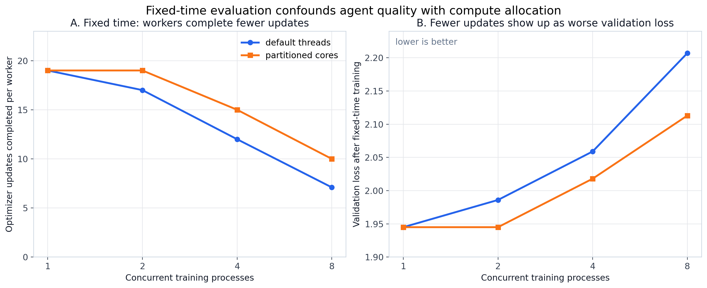
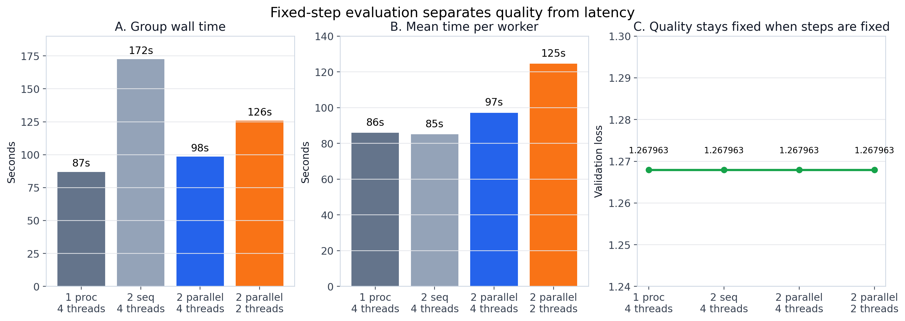
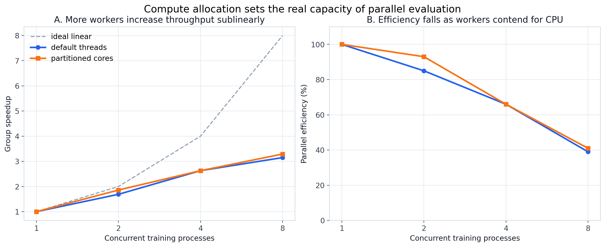

# Evaluation Protocol Calibration

**Status**: completed calibration
**Period**: April 2026
**Purpose**: make later agent-workflow comparisons deterministic and fair by
controlling both training randomness and the compute budget each worker receives.

These controls combine two related protocol checks that should not be separate
public experiments:

1. **Evaluator determinism**: repeated baseline runs must produce the same
   `val_bpb`, otherwise workflow comparisons can be explained by training noise.
2. **Compute allocation**: fixed wall-clock training budgets are hardware
   dependent, because concurrent workers can complete fewer optimizer updates.

The compute-scaling evidence here is CPU-only, but the methodological lesson
generalizes to GPU/CPU allocation: before comparing agent workflows, the
evaluator must control whether workers receive equal training compute or merely
equal wall-clock time.

## Central Message

The early pilots mixed three effects:

1. agent workflow quality: did parallel or memory-enabled agents make better
   choices?
2. evaluator protocol: did repeated runs use the same randomness and the same
   number of optimizer updates?
3. compute allocation: did parallel training jobs receive fewer optimizer
   updates because they shared the same CPU?

The calibration shows that evaluator noise and compute allocation were real
confounds.

- Five unmodified baseline runs produced identical `val_bpb = 0.811222` once the
  evaluator used fixed seed and fixed step count.
- Under **fixed-time** evaluation, more concurrent workers complete fewer
  optimizer updates and validation loss gets worse.
- Under **fixed-step** evaluation, all workers complete the same number of
  optimizer updates, so validation loss stays fixed; the cost moves to
  wall-clock latency.

Therefore, parallel agent evaluations should use fixed-step evaluation or
explicit compute accounting. Otherwise the experiment can mistake hardware
contention for poor agent decisions.

## Retained measurements

- [Determinism checks](results/evaluation-controls/evaluator_determinism/): five
  recorded fixed-seed, fixed-step runs with identical validation loss.
- [Fixed-time CPU scaling](results/evaluation-controls/fixed_time_cpu_scaling/):
  concurrency N=1,2,4,8 and optimizer-update/quality measurements.
- [Fixed-step CPU pair](results/evaluation-controls/fixed_step_cpu_pair_benchmark/):
  sequential/parallel latency at an equal optimizer-update count.
- [Figures](results/evaluation-controls/figures/): the three current control panels.

Superseded 2×2 memory pilots, their exploratory comparisons and historical plot
variants are retained under the [provenance tag](../../../docs/history-merge.md).
They are not evidence for an active memory-effect claim.

## Key Figures

**Figure 1**: with a fixed wall-clock budget, increasing concurrent training
processes reduces optimizer updates per worker. Validation loss worsens at the
same time. This is the core confound.

**Figure 2**: when each worker is forced to complete 300 optimizer updates,
validation loss is identical across sequential and parallel settings. Parallel
execution changes wall-clock time, not quality.

**Figure 3**: parallel evaluation increases group throughput, but sublinearly.
Efficiency falls as workers contend for CPU resources.

## Numbers To Remember

Fixed-time default CPU policy:

| concurrent processes | optimizer updates per worker | validation loss |
| ---: | ---: | ---: |
| 1 | 19.0 | 1.945 |
| 2 | 17.0 | 1.986 |
| 4 | 12.0 | 2.059 |
| 8 | 7.1 | 2.207 |

Fixed-step N=2 follow-up:

| condition | group wall time | mean worker time | validation loss |
| --- | ---: | ---: | ---: |
| 2 sequential workers, 4 threads | 172.44s | 85.10s | 1.267963 |
| 2 parallel workers, 4 threads | 98.48s | 97.15s | 1.267963 |

The parallel pair finishes the group workload 1.75x faster, but each worker is
14.2% slower. Quality is unchanged because the optimizer-update count is fixed.

## What This Means For Later Agent Experiments

Use this experiment as the reason for:

- fixed-step evaluation;
- serialized or CPU-aware training evaluation when comparing agent modes;
- separate reporting of agent deliberation time and evaluator training time;
- explicit compute accounting before interpreting parallel-agent quality.

This experiment does not prove whether parallel agents are better or worse. It
proves that the original fixed-time comparison could not answer that question
cleanly.
