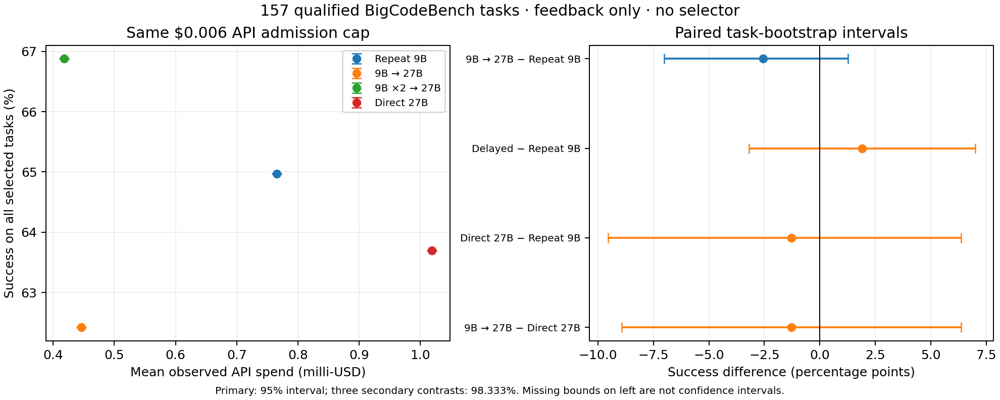
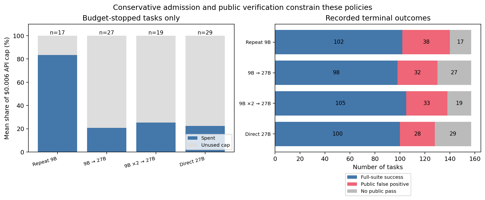

# Fixed feedback-only policies on new BigCodeBench tasks

All policies use public feedback only; no selector was trained.

Coverage: **157 task clusters**, 1 replicate per task. All frozen policy outcomes observed.

The reference-qualified standard-library subset is not representative of all BigCodeBench. These are new project queries, not proof of absence from model training data.

| Fixed policy | Successes / expected | All-selected success bounds | Mean API spend | Mean verifier seconds | Public false positives |
| --- | ---: | ---: | ---: | ---: | ---: |
| `small_feedback` | 102 / 157 | 65.0–65.0% | $0.000766 | 0.797 | 38 |
| `immediate_large_feedback` | 98 / 157 | 62.4–62.4% | $0.000446 | 0.323 | 32 |
| `delayed_large_feedback` | 105 / 157 | 66.9–66.9% | $0.000418 | 0.276 | 33 |
| `large_direct` | 100 / 157 | 63.7–63.7% | $0.001018 | 0.184 | 28 |

Equal budget means a **$0.006 API-dollar admission ceiling**, including the initial attempt. It does not mean equal realized spend, latency or local hardware cost. Fixed-rule selection uses zero API calls; local verification is measured separately. Every failure remains in the denominator.

## Prespecified primary comparison

Immediate 27B escalation minus repeated 9B: **-2.55 percentage points**, 95% task-bootstrap interval [-7.01, +1.27]. Complete paired task clusters: 157.

All-selected missing-outcome bounds: [-2.55, -2.55] percentage points. These bounds are **not confidence intervals**.

Primary gate: **not passed**. The gate requires a complete bank, a positive lower confidence endpoint and at least a five-point estimate. A passed gate alone would not establish an adaptive selector advantage. A failed gate does not establish equivalence.

## Secondary comparisons

The following intervals use 98.333% coverage for the three-comparison family; they cannot replace a failed primary outcome.

| Difference | Estimate (pp) | Task-bootstrap interval (pp) |
| --- | ---: | ---: |
| `delayed_large_feedback` − `small_feedback` | +1.91 | [-3.18, +7.01] |
| `large_direct` − `small_feedback` | -1.27 | [-9.55, +6.37] |
| `immediate_large_feedback` − `large_direct` | -1.27 | [-8.92, +6.37] |

## Collection and limits

Known collection charges: $0.38896675; unresolved full reservations: $0.00000000. The new collection cap is $4.00 under the separate $5 authorization. Shared prefixes are paid once in collection and charged separately in each deployment policy.

The policies stop at their first public pass even when full-suite evaluation fails. Public examples are weak tests; false positives can hide additional benefits or errors. Conservative token reservation can leave budget unused, especially for 27B. One replicate per task, one provider/precision, public benchmark contamination, qualification bias, a fixed budget point and unpriced local compute limit generalization. A 157-task study has limited power for modest improvements. No outcome-based task exclusion or learned tuning is allowed.

All policies assume feedback is the interface. This is **not a feedback-versus-no-feedback test**. The code-transfer findings in the previous MBPP+ study remain separate.



## Reproduce without credentials or candidate execution

```bash
uv run python scripts/analyze_feedback_routing.py \
  --input experiments/bigcodebench/feedback-only-routing/results/fixed-policies-20261022 \
  --output /tmp/feedback-only-analysis.json
```

The collector source freeze and private/public split are documented in `../../PROTOCOL.md`. `source-map.json` binds inert source snapshots to the collection commit; `checksums.json` covers published files.

## Latency and admission diagnostics

These are postcollection descriptive accounting checks, not extra efficacy hypotheses. The admission rule reserves a worst-case response at model-specific prices. An equal API cap therefore does not imply equal realized spend or equal opportunity to exhaust it. A lower bill alone does not establish equal-quality savings or an intrinsic escalation advantage.

| Policy | Mean attempts | Mean / median API seconds | Budget-stopped tasks | Mean cap used when budget-stopped |
| --- | ---: | ---: | ---: | ---: |
| `small_feedback` | 7.42 | 88.90 / 13.10 | 17 | 83.5% |
| `immediate_large_feedback` | 1.37 | 17.13 / 12.97 | 27 | 20.8% |
| `delayed_large_feedback` | 1.61 | 21.61 / 13.27 | 19 | 25.3% |
| `large_direct` | 1.10 | 13.00 / 11.50 | 29 | 22.5% |

Mean API seconds sum each policy's own model requests; they exclude local verification and collection queue time. The median helps distinguish tail retries from a speedup on a typical task. Budget-stop fractions are conditional on budget-stopped tasks, not averages over all tasks.

Of the 157 shared initial 9B responses, 105 passed the public examples but only 80 passed the full suite. The 25 initial public false positives terminate all three small-start policies before escalation is possible. This is an observed verifier limitation, not a measured benefit of adding stronger tests.



## Offline verifier repeat

Rechecked all 1492 preserved responses: reproduced 29 format errors and re-executed the public checks for every parseable solution and every originally executed full-suite check, under the same frozen sandbox verifier and RNG seed. Observed **0 responses with pass/fail discrepancies**. Original primary labels were retained throughout; no model request or paid inference was repeated. The diagnostic is preserved in [verification-repeat.json](verification-repeat.json). This repeat check does not establish correctness beyond the benchmark tests.

## Human-requested interim disclosure

After the freeze, the user requested one descriptive look at the 83 tasks then complete under all four policies. Its completion bias was disclosed. No interim confidence interval, p-value, primary gate, fitting, efficacy stopping or change to collection followed. The final protocol retains all selected tasks, failures and missing-outcome bounds; incomplete-bank intervals are descriptive. See [the preserved disclosure](interim-disclosure.md.txt) and [the immutable interim record](interim-record.json). The historical interim subset must not replace the final primary comparison.
