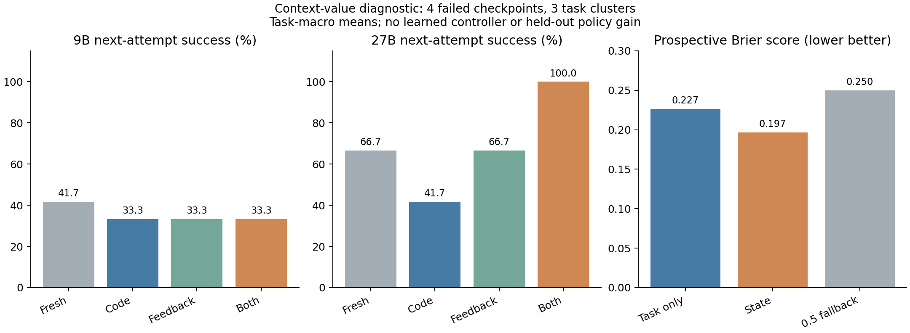

# Value of work after failure

Status: discovery diagnostic and a completed, amended producer-transfer evaluation
collected on 2026-10-22. Simple one-checkpoint selectors; no general multi-step controller.

Question: after a visible failure, does the previous artifact help the next
attempt, and can this benefit be forecast before paying for that attempt?

A subsequent [frozen transfer evaluation](VALIDATION.md) uses public-base feedback,
character-matched distractors, development-trained policies and task-disjoint
evaluation. Do not pool its outcomes with the doctest-only discovery below.

## Frozen producer-transfer result

The [audited bank](results/validation-20261022/report.md) contains 83 development
tasks (26 public failures) and 60 evaluation tasks (25 public failures):
**1,353 observed responses**, 1,020 matched recovery draws, 140 additional direct
controls and 50 prospective API forecasts. Gemma 3 4B / DeepInfra produced the
development failures. After explicit upstream-pool 429 stops before any observed
evaluation response, the unchanged frozen policy was tested on Ministral 3B / Mistral
failures. This is cross-producer transfer, not the original same-producer validation.

| Next solver, conditional on evaluation failure | Fresh | Code | Feedback | Both | Distractor |
| --- | --- | --- | --- | --- | --- |
| 9B | 66% | 50% | 64% | 62% | 64% |
| 27B | 84% | 86% | 80% | 86% | 86% |

Each cell has two draws on 25 independent failed tasks. The exploratory 9B
code-minus-fresh difference is −16 points, task-bootstrap interval [−30, −4],
without multiple-comparison adjustment. Relevant code+feedback does not clearly
outperform its character-matched unrelated control in this cohort. Provider token
lengths differ and are reported, not assumed equal.

At $0.01/task, state ridge solves 55/60 versus 53/60 for the prespecified per-draw
fixed rule. Its primary net-utility difference is +$0.00040765/task, 95% interval
[+$0.00003482, +$0.00095225]. The stronger development-replay fixed rule also solves
55/60; that utility difference is only +$0.00002851, interval
[−$0.00046099, +$0.00054027]. This does not establish a reliable gain over the
stronger static control. State/task Brier scores are nearly identical, and state
benefit MSE is worse in point estimate than unconditional priors. A model-only
ablation also reaches 56/60, without selecting the context package.

Known collection charges are $0.4836466. Six admissions without preserved response
identities retain $0.0082944; with the prior $0.0230224 discovery, the conservative
campaign amount is **$0.5149634** under the approved $2 ceiling. Seven explicit
empty provider errors remain failed draws at policy-backed zero charge. See the
receipts, stopped manifests and engineering disclosure in the results directory.
CPU verification and prediction time are recorded separately from API dollars.

Read the [blog draft](../../../docs/blog/when-to-keep-failed-code.md),
[related-work check](../../../docs/recovery-related-work.md), and full report
before making a method claim. The 60 evaluation tasks are now observed; future
tuning cannot reuse them as an untouched test. The 19 reserve tasks remain unused.

```bash
uv sync --dev --frozen
uv run python scripts/analyze_recovery_validation.py \
  --input experiments/humaneval-plus/context-value/results/validation-20261022 \
  --output runs/recovery-reanalysis
```

This audits saved data without model calls, credentials or candidate execution.
New collection requires optional EvalPlus, explicit intent/budget and a fresh
output directory. The protocol preserves both original and amended configs.

## What discovery found

The [audited collection](results/study-20261022/report.md) has **30 new tasks,
60 initial attempts, four failed checkpoints across three tasks, 64 matched
branch draws, and eight prospective forecasts**. Initial full-suite success was
56/60. Every failure was visible in public examples; no initial visible false
positives occurred in this subset. The 132 API calls cost **$0.0230224**, including
$0.0005398 of forecasts, with no unresolved receipts. The reference-preflight
engineering stop cost zero; see [attempt disclosure](results/engineering_attempts.json).
Collection source: `e3f4b85`; the manifest pins config and task hashes. The
analysis includes its own source SHA-256. Account balances and credentials are
excluded from the curated bundle.

| Next solver | Fresh | Code only | Feedback only | Code + feedback |
| --- | --- | --- | --- | --- |
| 9B | 41.7% | 33.3% | 33.3% | 33.3% |
| 27B | 66.7% | 41.7% | 66.7% | 100.0% |

These are **conditional, task-macro full-suite success rates**, not overall
benchmark accuracy: average draws within checkpoints, checkpoints within tasks,
then the three tasks equally. There are too few task clusters for the declared
bootstrap interval. The 100% cell is eight draws on four checkpoints, not eight
independent tasks or a guarantee.

The cases explain why a universal reuse rule would be premature:

- **HumanEval/4, missing import:** every condition recovered with both models.
  Supplying the previous code provided no measured success advantage here.
- **HumanEval/93, letter case:** the 27B solved both code+feedback draws and
  failed both draws in each other condition. The 9B failed all conditions.
  This is one observed case of model-dependent complementarity between code
  and feedback, not a general effect estimate.
- **HumanEval/54, character sets:** the failed programs compared character
  multiplicities. Across its two parent checkpoints, 27B fresh solved 4/4,
  code-only solved 1/4, and feedback-only/code+feedback each solved 4/4.
  The 9B fresh solved 1/4 and the other conditions each solved 0/4. Supplying
  incorrect code can preserve a wrong interpretation even when feedback is present.

State forecasts had task-macro Brier 0.19663 versus task-only 0.22654 (lower is
better). **This does not establish that context benefit is predictable.** The
improvement is driven by HumanEval/93; state forecasts were worse on HumanEval/4
and, averaging its two checkpoints, HumanEval/54. All state forecasts predicted
a positive code+feedback-versus-fresh benefit, missing the adverse 9B outcome at
checkpoint 55. Better overall outcome forecasting is not the same as correctly
predicting the difference between actions.

A state forecast costs $0.00008010 per failed checkpoint on a task-macro basis,
about 1.7 times a fresh 9B branch ($0.00004806), before paying for the chosen
branch. Its economic value needs a separate policy comparison.

The supported conclusion is that **the effect of supplying failed work can vary
with the error, available feedback and next solver**. We have not demonstrated a
reliable decision rule. More diverse failed tasks and task-disjoint validation
are needed before fitting or claiming a controller. The 19 reserve tasks were
not used for model calls. This diagnostic is kept separate from manuscript evidence.



## Frozen collection

- HumanEval+ v0.1.10 / EvalPlus 0.3.1; same dataset hash as the first pilot.
- Shuffle all 74 tasks with executable public doctests with seed 20261023,
  exclude the first pilot's 24 tasks and `HumanEval/47`, take 30, and reserve
  the remaining 19. The reference preflight found an inconsistent public median
  example in task 47 (expected 15.0 instead of 8.0) before any model call.
  This is a selected public-doctest subset, not the complete benchmark.
- Two fresh Qwen3.5-9B prefixes per task. Keep every initial outcome. Only
  visible failure triggers branches; broader-suite results never enter a prompt,
  feature, task-selection rule, or retry trigger. No manufactured failures.
- For each failed checkpoint, both 9B and 27B get four input conditions:
  task alone; task + code; task + public feedback; task + code + public feedback.
  Use the same solve/revise/discard instruction, two draws per cell, randomized
  order, and the exact same parent artifact/feedback. There is no hidden-state
  continuation or private reasoning access.
- Before any child outcome, query a 9B zero-shot probability forecaster twice:
  task only (knowing that an earlier attempt failed), then full observable state,
  with randomized view order. Each predicts all eight model/condition cells.
  Invalid forecasts remain counted with a predeclared 0.5 fallback.
  There is one forecast sample per view/checkpoint; its sampling variation is
  not separately averaged out by the branch repeats.
- All generation uses the first pilot's pinned SiliconFlow FP8 provider,
  temperature 0.6, no reasoning, no provider fallback, no sampler seed,
  maximum 1536 output tokens; input admission ceiling is 32768 tokens.
  Record all messages, receipts, failures, artifacts, forecasts, and evaluations.
- Explicit newly authorized total ceiling: **2 USD**. Do not automatically retry
  uncertain requests. Include forecast calls in collection cost; keep candidate
  verification wall time separate from money. Fixed-arm deployment costs include
  the prefix once and one chosen branch. A forecast-based deployment would also
  pay for its forecasting call. This study does not evaluate such a controller.

## Analysis decided before outcomes

Compare artifact+feedback with fresh, artifact alone with fresh, feedback alone
with fresh, and their factorial interaction separately for each target model.
Average repeated draws within checkpoints, checkpoints within tasks, then tasks.
Use task-cluster bootstrap intervals only with at least five failed tasks;
report insufficient coverage otherwise. Do not treat branch draws as tasks.

Compare prospective Brier scores for task-only versus state forecasts against
the realized individual branch draws, including malformed-forecast fallbacks.
Only fully observed matched checkpoints enter these paired comparisons; retain
and disclose incomplete checkpoints and all their costs. No policy fitting,
post-hoc classifier selection, or stopping based on observed advantage.

This estimates the practical effect of supplying additional context, including
its token cost. There is no token-length-matched irrelevant-context control, so
it does not isolate semantic information from input length/framing. Public
feedback can quote code snippets, so the feedback condition is not guaranteed
to contain zero artifact information. A broader prior-art review and stronger,
untouched evaluation would still be needed for a novelty or general-gain claim.
The 19 reserve tasks remain untouched for a later frozen policy evaluation.

Do not fit a state classifier from a handful of failed tasks. Before training,
collect diverse natural failures and freeze a task-disjoint validation protocol.
If this subset saturates, improve task difficulty and the observable verifier
rather than increasing retries on the same few errors. A coverage target is not
a substitute for a power calculation or an equal-budget policy comparison.

## Reproduction

```bash
uv sync --dev --extra continuation-pilot --frozen
uv run python scripts/run_context_value.py \
  --config experiments/humaneval-plus/context-value/configs/study.json \
  --output runs/context-value-plan
```

Planning makes no model calls. Authorized collection adds `--live --budget-usd 2`
and uses a fresh output directory. Supply the key through `--key-stdin` or the
environment, never CLI arguments/tracked files. Uses the same macOS OS sandbox,
reference preflight, protected feedback channels, and strict billing ledger as
the [initial pilot](provenance/continuation-pilot/README.md).

Dataset/task licensing: see the [upstream notices](../NOTICE.md).

Recompute the saved-data audit, paired estimates and figure without credentials:

```bash
uv run python scripts/analyze_context_value.py \
  --input experiments/humaneval-plus/context-value/results/study-20261022 \
  --output runs/context-value-reanalysis
```

Use a fresh output directory. Analysis reads recorded data and does not run
candidate programs or contact a model provider.
