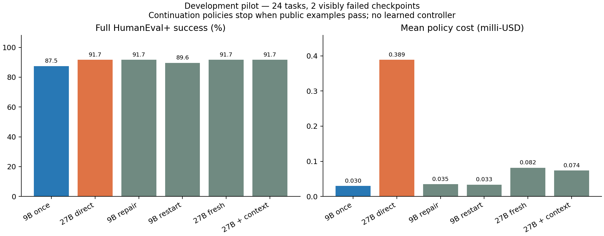

# OpenRouter continuation pilot

Status: development collection completed on 2026-10-22; no learned controller
or held-out gain.

Qwen3.5 9B and 27B use the same `siliconflow/fp8` endpoint without fallbacks.
Size is an experimental attribute, not an intelligence measurement or a causal
intervention that holds pretraining and post-training fixed.

## Frozen protocol

- HumanEval+ v0.1.10, EvalPlus 0.3.1, dataset MD5
  `fe585eb4df8c88d844eeb463ea4d0302`.
- Shuffle numerically ordered tasks with executable public-docstring examples
  using seed `20261022`; take 24. Eligibility uses public prompts, never model
  outcomes. This favors doctest-style documentation and does not represent the
  full benchmark. Exclude these tasks from future held-out controller evaluation.
- One initial 9B attempt and two independent direct 27B attempts per task.
  Temperature 0.6, maximum 1536 output tokens, reasoning disabled, JSON with a
  complete Python solution. SiliconFlow does not advertise a sampler seed, so
  none is sent. Local seeds fix selection/order, not generation; save requests.
  Reference solutions must pass visible and full tests before spending.
- Visible feedback uses only examples already in the prompt. Compare equivalent
  Python literals despite quote-style differences; a public predicate without
  printed output is required to evaluate to True. Full EvalPlus base/plus scores
  never trigger branches or appear in feedback.
- Passing visible examples stops a policy, including false positives subsequently
  found by EvalPlus. On visible failure, sample two continuations per action:
  9B repair, 9B fresh restart, 27B fresh restart, 27B repair with the original
  transcript/public feedback. Both repair actions receive identical messages.
  Interleave controls and branch draws in a frozen shuffled order.
- Repeats share an exact parent checkpoint; they are not independent tasks.
  Compare only fully observed matched tasks. Learned multi-checkpoint policies
  and length-matched context controls are future work. The direct 27B control
  is one attempt per draw, not an optimized strong-model retry policy under
  an equal per-task dollar budget. This pilot establishes neither controller
  superiority nor causal informative-context gains.

## Cost and execution

Explicit budget: at most **2 USD**. Each serial call reserves its worst-case
token charge at the configured price ceilings: 16,384 input and 1536 output
tokens. UTF-8 message bytes plus a framing allowance must fit the input ceiling.
Requests require FP8, supported parameters, maximum prices and no fallbacks.
Preflight checks real credit and exact endpoint availability/prices.

Ceilings in USD per million tokens: 9B input/output 0.10/0.15; 27B 0.25/2.00.
Stream completions with keepalive support and record the final authoritative
`usage.cost`, token/cache/reasoning details, provider, generation
ID, latency, messages and output. Invalid/truncated output is charged and scored
as failure. Unknown billing keeps its reservation and stops; no automatic retry
or resume of an existing journal is allowed. Unexpected over-ceiling receipts
are recorded and halt further calls. The bound relies on provider enforcement
of requested token and price limits.

Policy cost includes the prefix once plus the chosen action. Collection cost
pays for all counterfactual draws. Record candidate-verification wall time separately without an
invented dollar conversion; reference preflight/setup time is not included in
that candidate-only total. The small development sample supports no held-out
gain, optimality or statistical-significance claim.

```bash
uv sync --dev --extra continuation-pilot --frozen
uv run python scripts/run_continuation_pilot.py \
  --config experiments/humaneval-plus/openrouter-continuation-pilot/configs/pilot.json \
  --output runs/continuation-plan
```

Default: write a task/config manifest with no model calls. An explicitly
authorized paid run adds `--live --budget-usd 2` and a fresh output directory.
Supply `OPENROUTER_API_KEY` in the local environment, or use `--key-stdin`.
Never put credentials in arguments, configs, tracked files or transcripts.

Live verification currently requires **macOS sandbox-exec**. It clears child
credentials, denies network and user-home/other-temporary-workspace reads,
allows OS/interpreter/library reads and run-local writes, bounds execution/output,
and probes isolation before calling models. Unsupported hosts fail closed.
Linux CI tests offline logic; a portable container backend is future work.

Outputs: `manifest.json`, append-only `budget.jsonl`, `calls.jsonl`,
`evaluations.jsonl`, `outcomes.jsonl`, `summary.json`, and `report.md`.
Curated results must exclude API keys, account identifiers and account balances.

Task/evaluator attribution is preserved in [NOTICE.md](NOTICE.md).

After a completed run, regenerate the receipt audit and exploratory plot:

```bash
uv run python scripts/analyze_continuation_pilot.py --input runs/continuation-live
```

Use the actual live output directory in place of `runs/continuation-live`.

## Observed development results

The [curated run](results/pilot-20261022/report.md) contains 24 matched tasks,
88 billed calls, and all saved requests, candidate programs, separate visible
and full-suite evaluations, policy outcomes, and usage receipts. Its collection
source is commit `87c425e`; the manifest pins configuration and task-prompt hashes.
The [receipt audit](results/pilot-20261022/audit.json) reconciles every accepted
run charge against the reservation journal.

| Prespecified policy | Full-suite success on this subset | Mean API cost per task (USD) |
| --- | --- | --- |
| 9B once, then stop | 87.5% (21/24) | 0.00002998 |
| 27B direct, one attempt per draw | 91.7% (44/48 draws across 24 tasks) | 0.00038856 |
| 9B, then same-model repair on visible failure | 91.7% | 0.00003465 |
| 9B, then same-model fresh restart on visible failure | 89.6% | 0.00003344 |
| 9B, then 27B fresh restart on visible failure | 91.7% | 0.00008156 |
| 9B, then 27B with context on visible failure | 91.7% | 0.00007364 |

Continuation-policy means include stopped prefixes, including hidden failures;
they are not conditional repair pass rates. Each continuation has two draws per
failed checkpoint, and rates are averaged by task. Policies are fixed rules,
not actions selected by a trained controller. Direct-model controls are not
optimized equal-dollar-budget retry baselines.

Only **two** initial checkpoints failed visible examples: `HumanEval/1` omitted
`typing.List`; `HumanEval/91` mishandled sentence boundaries/leading whitespace.
The four actions produced 16 actual continuations. Seven passed full HumanEval+:
7/8 on the import case and 0/8 on the sentence case. Some repairs passed the
public examples while still failing broader tests. `HumanEval/57` was an initial
public-example false positive. Both direct 27B draws failed the extra tests on
`HumanEval/55` and `HumanEval/91`.



This validates collection, transfers, isolation, and cost accounting. Two failed
states do not establish learnable state-dependent action superiority, model-size
scaling laws, or a general 11x cost-saving claim. Do not train a forecaster on
this sample. The next scientific step requires more diverse genuine failures,
stronger declared public feedback, budget-matched controls, and untouched
held-out tasks.

The accepted run cost **$0.024332**. Including excluded engineering attempts,
recorded charges are **$0.027331**. Two unanswered non-streaming requests retain
**$0.0090368** in conservative unresolved reservations: recorded charges plus
those bounds total **$0.0363678**, within the authorized $2 ceiling. The earlier
annotation-inheritance verifier bug and non-streaming network failures are
excluded from every comparison and disclosed in
[engineering accounting](results/engineering_attempts.json). The accepted run
has no unresolved receipts. Candidate verification took 83.1 wall seconds;
reference preflight/setup is excluded from that candidate-only timing.
