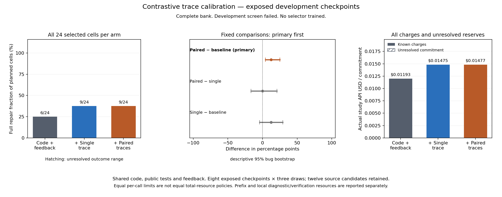

# Paired public traces: positive aggregate difference, development screen failed

All **72 requests completed** on eight already exposed failed checkpoints. Full
public-plus-evaluator repairs were **6/24 with code and feedback**, **9/24 with
one failing trace**, and **9/24 with failing/passing traces**. The prespecified
primary paired-trace advantage is **+12.5 percentage points**, with a descriptive
95% bug-bootstrap interval of **[+4.167, +25.0] points**.

The development screen nevertheless **fails**: the net paired advantage across
the three draw indices is **+3, 0, 0**, and the total gain is three rather than
the required four. Three bugs meet the repeated-success condition. A descriptive
interval that excludes zero does not replace the prospectively fixed screen or
make this small, repeatedly inspected development sample confirmatory. No selector
is trained; repeatable acquisition benefit remains unestablished.



## What was compared

The [frozen protocol](../../CONTRASTIVE-STUDY-PROTOCOL.md) fixed Qwen3-Coder-Next,
Parasail/BF16, three matched draws per arm, balanced arm ordering and identical
core prompts. Every arm received the same code, instructions, all existing public
tests/expected values and public feedback. Only the runtime diagnostic changed.
The pair adds the execution of an already-passing public input selected by the
fixed input-similarity rule. It does not reveal a new expected answer.

Seven selected bugs derive from youtube-dl and one from httpie. All twelve source
candidates remain in provenance; the four public-pass sources were not repaired,
including sources that fail private evaluation. These are adapted development
functions, not a held-out repository-level benchmark. All 72 request bodies are
fresh and disjoint from historical planned requests. No interim outcome analysis,
retry, fallback, key rotation or new uncertain charge occurred.

| Outcome | Code + feedback | + Failing trace | + Failing/passing traces |
| --- | ---: | ---: | ---: |
| Received / planned | 24/24 | 24/24 | 24/24 |
| Complete repairs | 6 | 9 | 9 |
| Decoded artifacts | 24 | 24 | 24 |
| Syntactically valid Python | 22 | 23 | 23 |
| Public passes | 8 | 12 | 11 |
| Public pass but evaluator failure | 2 | 3 | 2 |
| Net public-score regressions | 5 | 2 | 3 |
| Missing outcomes | 0 | 0 | 0 |
| Actual API USD | 0.01192604 | 0.01475424 | 0.01476588 |

| Development bug | Code + feedback | + Failing trace | + Failing/passing traces |
| --- | ---: | ---: | ---: |
| youtube-dl-003 | 0/3 | 1/3 | 0/3 |
| youtube-dl-013 | 0/3 | 1/3 | 1/3 |
| youtube-dl-020 | 0/3 | 1/3 | 0/3 |
| youtube-dl-031 | 1/3 | 0/3 | 2/3 |
| youtube-dl-033 | 2/3 | 3/3 | 3/3 |
| youtube-dl-042 | 0/3 | 0/3 | 0/3 |
| youtube-dl-043 | 3/3 | 3/3 | 3/3 |
| httpie-005 | 0/3 | 0/3 | 0/3 |

The fixed paired-minus-single secondary difference is zero, with descriptive
interval [−16.667, +20.833] points. Equal totals do not imply the same bugs were
repaired or prove equivalence. Single-minus-baseline is +12.5 points with interval
[−4.167, +29.167]. Neither secondary can replace the primary result.

The [preceding complete bank](../information-independent-20261026/README.md)
found 12/32 baseline versus 8/32 trace repairs. It remains separate: no pooling,
replacement controls or revised historical gate. The changed trace representation
and fresh stochastic draws do not isolate why the direction differs.

## Resources and next decision

New API spending is **$0.04144616** of the declared $0.40 suballocation. Carrying
**$0.16495655 exactly once**, including thirteen historical unresolved reserves,
gives **$0.20640271 / $0.60** cumulative commitment. This bank adds no uncertainty.
Old reserves are neither repeated nor refunded.

Each arm additionally has $0.00329760 of counterfactual source-prefix API cost
and 8.119529 measured seconds of source verification across hypothetical
deployments. Single-trace acquisition charges 48 sandbox executions and 3.146098
seconds; paired acquisition charges 96 and 5.761234 seconds. These cached research
diagnostics are charged per deployment. Public response verification and private
research evaluation are separate fields in the analysis. Local time is not
converted to API dollars; full policy overhead still needs enforcement.

Equal per-call limits are **not an equal-total-resource policy comparison**.
The observed increase in repairs does not establish that the diagnostic repays
its generation, acquisition and selection costs. The [post hoc failure audit](POSTHOC.md) retains all 72 responses: 46
correct some original public failure, but only 24 fully repair. It motivates
reviewing acquisition timing/coverage before any separately specified revision. The [information-access review](../../INFORMATION-ACCESS-REVIEW.md)
records relevant prior work and prevents treating already visible expected values
as newly acquired information. The final objective remains a prospective selector
that beats the strongest fixed policy on untouched grouped bugs.

## Reproduction

[Analysis](analysis.json), [generated report](REPORT.md), [inert archive](evidence.zip)
and [manifest](evidence-manifest.json) preserve all selected cells and frozen
sources. [Independent replay](reverification.json) reproduced the complete analysis
and Markdown, reexecuted both public diagnostic projections, and matched **144
saved evaluations / 140 unique input suites with zero discrepancies**. The
[figure audit](figure-audit.json) records visual inspection against that report.
Raw SSE bytes are not archived; saved metrics are not byte-level wire replay.

- Frozen source: `3846e157c0a8c2ef6992f85a52b724c6b6de1a6b`.
- Freeze: `076ef7714452f3af940c45637ed0a5e99665d12f366aee6fea44b3c837311ee6`.
- Archive: `3205581a96e28f215cae5b23122cda831888c231ccd1a2b04b1eb69af61ac1a6`.

```bash
uv run python scripts/verify_repair_contract_evidence.py \
  --input experiments/python-repair/checkpoint-environment/results/contrastive-calibration-20261026 \
  --output runs/contrastive-independent-replay.json
uv run python scripts/plot_repair_contrastive_study.py \
  --input experiments/python-repair/checkpoint-environment/results/contrastive-calibration-20261026/analysis.json \
  --output runs/contrastive-terminal-figure
```

Use fresh output paths. These commands make no model calls. Historical studies,
manuscripts and failed screens are preserved. This delivery does not complete
the selector objective.
