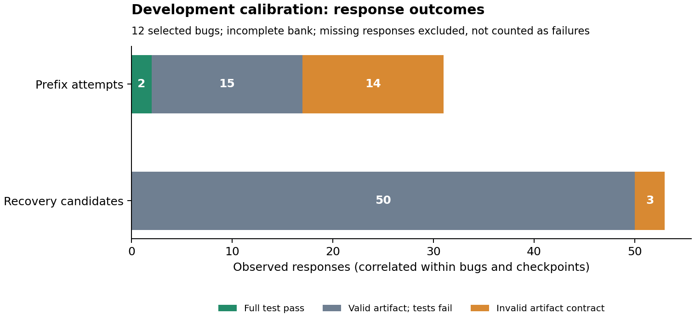

# Gemma 3 4B calibration: no basis yet for a recovery selector

The current development setting has not produced useful recovery evidence.
Across **53 observed recovery responses, none passed both test suites**. The
matched comparison contains **11 complete checkpoints from only four bugs**;
all five fixed/two-candidate policies score zero there. This does **not** establish
that continue and restart are equivalent: missing states, small clustered data
and an unsuccessful solver setting prevent that conclusion. Degenerate zero
bootstrap intervals are descriptive, not proof of zero population differences.

Read the [full report](REPORT.md), [machine-readable analysis](analysis.json),
[original protocol](../../PILOT-PROTOCOL.md) and
[operational amendments](../../PACING-AMENDMENT-20261026.md).

## What the pilot established

- The full bank contains **84 responses / 88 admissions**, across 12 selected,
  inspected BugsInPy adaptations. Of 24 planned trajectories, 18 finished,
  four are partial and two never started. Checkpoints/replicates are not new bugs.
- **17 responses are empty JSON objects `{}`**, despite a normal stop reason.
  They contain no patch to salvage with a looser parser. They remain paid
  artifact-contract failures. Fourteen are prefix responses, three are recovery
  responses. This alone does not explain the valid-code failures.
- Of 31 prefix responses, only the two Tornado replicates fully succeed;
  15 valid artifacts fail and 14 are empty objects. Of 53 recovery responses,
  50 valid artifacts fail and three are empty objects. No public-test false
  positives were observed. Five prefix no-ops and two score regressions remain
  in the data; absence of other score improvements is a calibration finding.
- Actual recorded generation charges are **$0.00405203**. Four unresolved
  reservations total **$0.00606208**, giving **$0.01011411** conservative
  commitment against the separate $0.60 ceiling. No uncertain request was retried.
  These are API amounts, not an all-in local-compute price.
- The final segment stopped on HTTP 429 despite 60-second dispatch spacing.
  The predeclared operational cutoff closed the pilot; there is no successor.
  The first segment's unknown exception is not retrospectively labeled 429.



The engineering result is useful: exact prompts, costs, branch ancestry and
partial results survived all interruptions. It is not a successful selection
method. Ten of twelve bugs are from youtube-dl; none is an untouched test set.
The result is specific to this model/provider, prompts and adapted task pool,
not a general inability of Gemma 3 4B to debug Python.

## Verification and reproduction

Every saved request projection, receipt, reservation, source hash and branch
ancestry passes the audit. The portable [evidence archive](evidence.zip) and its
[hash manifest](evidence-manifest.json) retain original relative paths and all
four segment freezes. Collector source snapshots are inert `.txt` files.
All outcome/cost fields and Markdown reproduced from an isolated extraction.
Fresh replay-selection timings are explicitly excluded from exact equality.

We also re-executed **156 stored evaluation records**, deduplicated into **32
unique artifact/test-suite inputs**, using the existing macOS sandbox: **zero
discrepancies, zero API calls**. See [reverification.json](reverification.json).
Deduplication is a compute optimization, not additional independent evidence.

From a clean installed checkout, extract into a fresh directory without altering
any ancestor manifest. The standard analysis is read-only and portable;
`--reverify` additionally needs macOS `sandbox-exec` and executes saved candidate
code only through that isolated verifier.

```bash
mkdir runs/repair-evidence-replay
python -m zipfile -e experiments/python-repair/checkpoint-environment/results/gemma4b-calibration-20261026/evidence.zip runs/repair-evidence-replay
cd runs/repair-evidence-replay
../../.venv/bin/python -m vao.analysis.repair_calibration \
  --input runs/repair-gemma4b-development-final-20261026 \
  --output report --allow-interrupted --reverify
```

Compare `analysis.json` excluding `replay_selection_timings`; compare the full
Markdown and evaluation outcomes, not machine-dependent rerun durations. Never
execute the archived source snapshots or model artifacts outside the verifier.

## Next development decision

**Do not train the selector on this bank.** First separate the output-contract
problem from task solvability in a new, small development calibration. A concrete
candidate is a 12-task, three-contract comparison: the current JSON contract,
JSON with one unrelated syntax-only example, and plain Python for these single-file
tasks. Keep model/provider, task, public feedback, sampling and allowance fixed;
report that contract changes can include serving-mode changes. Measure valid
artifacts and fully solved distinct bugs before collecting recovery branches.
This would require a new protocol, exact prompts, freeze and authorization;
no such calls have been launched. It is a diagnostic on already inspected tasks,
not a holdout or an adaptive-selector gain. Retain the full empty/failed/missing
bank above rather than replacing it with favorable samples.
