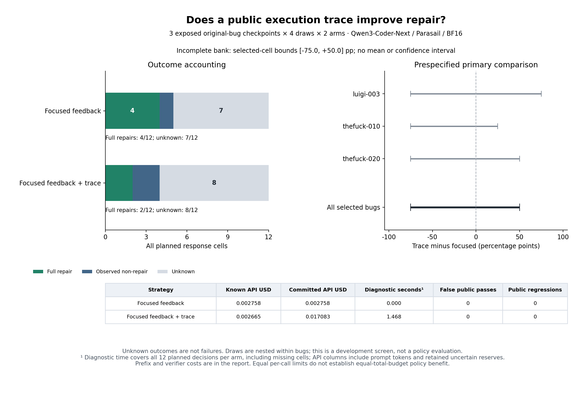

# Independent extension trace calibration: interrupted, inconclusive

This separate development calibration received **9 of 24 planned responses**
on Luigi/3, The Fuck/10 and The Fuck/20 before the second transport error stopped
collection. Eleven requests were admitted: nine received outcomes, two uncertain
requests retaining their full reserves, and thirteen never-admitted cells. All
24 selected cells remain in the analysis. No retry, resumption or successor is
permitted by this protocol.

| Arm | Received / planned | Full repairs | Public false acceptance | Public-score regressions | Unknown |
| --- | ---: | ---: | ---: | ---: | ---: |
| Focused public feedback | 5 / 12 | 4 | 0 | 0 | 7 |
| Identical feedback + public trace | 4 / 12 | 2 | 0 | 0 | 8 |

The fixed primary contrast, trace minus focused, has finite selected-cell bounds
of **−75 to +50 percentage points**. These are not confidence intervals. Its mean
and descriptive bootstrap remain null; the prespecified screen is inconclusive.
Neither trace benefit nor its absence is established. Both uncertain requests
belong to the trace arm; missingness is not assumed random. Comparing only the
received proportions would not resolve this incomplete experiment.

These are three inspected, function-level development adapters from two projects,
with four draws per arm, not twelve independent bugs or an untouched evaluation.
Each checkpoint is an original upstream buggy version after public-test failure,
not a model-produced patch. Model/provider/precision, public information, output
contract and verification stayed fixed except for the bounded public runtime
trace. The previous eight-checkpoint study is a separate protocol and is not
pooled with this bank. No treatment outcomes were inspected while collection
was active, and no selector was trained.



## What the interruption establishes

Both errors were `ConnectionResetError` during `reading_response`, at recorded
exchange elapsed times of 14.969 and 12.188 seconds. No HTTP status was recorded.
The prospective rule retained the first unknown reservation, waited 120 seconds
and advanced only to another independent, never-admitted cell; the second error
stopped collection. Neither uncertain request was repeated or replaced.

The new phase logs localize the exceptions to response-body reading. They do
not identify whether the local network, an intermediary or the service caused
the resets. These are not recorded HTTP 429 responses or 180-second timeouts.
Changing transport requires a separate engineering validation and prospective
freeze; it cannot fill this study's missing outcomes.

## Accounting and independent reproduction

Known new API charges are **$0.00542396**; two unresolved reservations add
**$0.01441792**. Study commitment is **$0.01984188 / $0.18**. Carrying
$0.08592275 exactly once gives cumulative repair commitment of
**$0.10576463 / $0.60**, including eleven historical/current unresolved requests.
No paid receipt lacks an outcome. Unspent allocations are not an automatic
continuation budget. No key rotation, fallback or generation lookup was used.

The [full analysis](analysis.json) separates actual API charges from local
acquisition and verification. Diagnostic totals cover all **12 planned decisions
per arm**, including missing cells: 24 trace executions and 1.468 seconds for
the trace policy. Initial public verification projects 4.376 seconds per arm;
there is no generated-prefix API cost. Actual response-verification totals are
3.914 seconds for focused and 3.039 for trace. These are recorded resources, not
a controlled deployment-latency comparison. Equal per-call limits do not establish
a policy advantage under equal total resources.

The [independent sandbox replay](reverification.json) reproduces the full
analysis and generated Markdown exactly: **18 saved evaluation records,
18 distinct artifact/suite inputs, zero discrepancies**. Public diagnostic
projections also reexecute identically. The sandbox denies network/filesystem
access and receives no credentials. The [figure audit](figure-audit.json)
records input/script/image hashes and visual review.

Frozen source: `110c0f897635a450c1b2a965e3fef4b36ad8e409`.
Freeze: `83f95365af7429007bca4134967fd5f94e9d65f72f19709c5fba34e0d4e5753c`.
Evidence archive SHA-256:
`99cca40cacf207d8e6fa26a81cb491f548c4fb52226beebcac351aceb61d13fa`.
Read the [prospective protocol](../../EXTENSION-INFORMATION-PROTOCOL.md),
[generated report](REPORT.md) and [hash manifest](evidence-manifest.json).
The archive retains inert frozen sources, all admitted requests and receipts,
the two uncertain requests and the original planned schedule.

From the repository root, after checking archive/member hashes and extracting
into a fresh directory:

```bash
uv run python scripts/report_repair_information_study.py \
  --input <extracted>/collection --output <fresh-report-directory>
uv run python scripts/verify_repair_contract_evidence.py \
  --input experiments/python-repair/checkpoint-environment/results/information-extension-stopped-20261026 \
  --output <fresh-reverification.json>
uv run python scripts/plot_repair_extension_information.py \
  --input experiments/python-repair/checkpoint-environment/results/information-extension-stopped-20261026/analysis.json \
  --output <fresh-figure-directory>
```

The research goal remains active. Reliable collection, repeatable information
value, equal-total-budget fixed-policy comparison and prospective selection on
untouched bugs remain unproved. Resolve the transport dependency before another
scientific bank; do not train on these sparse action differences.
