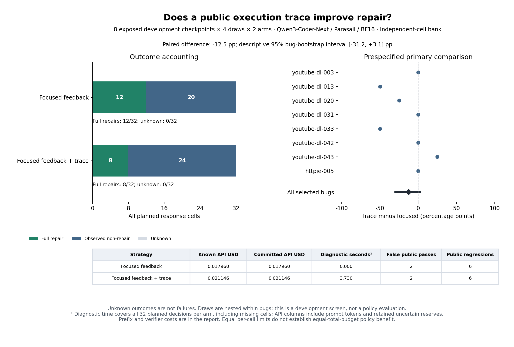

# Complete independent-cell trace calibration: development screen failed

**Adding this bounded public execution trace did not pass the prespecified
benefit screen.** All 64 planned requests completed: focused public feedback
produced **12/32 complete repairs (37.5%)**, versus **8/32 (25.0%)** with the same
feedback plus a trace. The paired difference is **−12.5 percentage points**;
the descriptive 95% bug-bootstrap interval is **[−31.25, +3.125] points**.
This interval crosses zero. The selected development bank does not establish
population harm, an absence of all possible diagnostic benefit, or generalization.



## Design and preserved outcomes

The [prospective protocol](../../INDEPENDENT-INFORMATION-PROTOCOL.md) fixed eight
already exposed failed checkpoints (seven youtube-dl, one httpie), four draws
per arm, Qwen3-Coder-Next / Parasail / BF16 and matched generation seeds. Only
`runtime_diagnostic` differs within each pair. All twelve original source tasks
remain in the report; four public-pass sources were not repaired and do not
become successful hidden-evaluator cases by assumption.

All 64 requests are new and disjoint from the 556 unique planned bodies in
fourteen prior frozen archives. Historical controls, incomplete banks and
missing cells were not reused, pooled or filled. No interim treatment analysis
was performed. All 64 receipts and outcomes are present; there was no error,
retry, fallback, key rotation or retained new uncertainty in this bank.

| Outcome | Focused feedback | Focused feedback + trace |
| --- | ---: | ---: |
| Received / planned | 32/32 | 32/32 |
| Complete public-plus-evaluator repairs | 12 | 8 |
| Usable artifacts | 32 | 31 |
| Public passes | 14 | 10 |
| Public pass but evaluator failure | 2 | 2 |
| Public-score regressions | 6 | 6 |
| Missing outcomes | 0 | 0 |
| Known API USD | 0.01795952 | 0.02114576 |

The unusable trace-arm reply remains an observed unsuccessful attempt. No output,
false acceptance, regression or original source candidate is excluded.

| Development bug | Focused full repairs | Trace full repairs |
| --- | ---: | ---: |
| youtube-dl-003 | 1/4 | 1/4 |
| youtube-dl-013 | 2/4 | 0/4 |
| youtube-dl-020 | 1/4 | 0/4 |
| youtube-dl-031 | 1/4 | 1/4 |
| youtube-dl-033 | 4/4 | 2/4 |
| youtube-dl-042 | 0/4 | 0/4 |
| youtube-dl-043 | 3/4 | 4/4 |
| httpie-005 | 0/4 | 0/4 |

These are four stochastic draws per arm, not four independent bugs. One bug has
more observed trace repairs, three have fewer and four are tied. These exposed,
sparse differences cannot establish predictable action complementarity or supply
a validated selector. The frozen screen requires at least three bugs with two
trace successes, at least four net extra successes, and a positive difference
in both draw halves. Observed values are two bugs, **−4** net successes, and
**−1 / −3** across halves. The screen fails; no selector is trained.

## Accounting and interpretation

New API spending is **$0.03910528**, below the separate **$0.47** allocation.
Carrying **$0.12585127** once gives **$0.16495655 / $0.60** cumulative commitment,
including the unchanged **thirteen historical unresolved reservations**. The
current bank adds no uncertain reserve and never refunds the historical ones.

Trace-arm API spending is 17.74% higher in this selected bank. The report also
charges 64 diagnostic sandbox executions and 3.7301205 measured seconds across
its 32 hypothetical deployments. Diagnostics cached for research are charged
per deployment. Each arm additionally carries $0.00439680 of counterfactual
source-prefix API cost and 10.4272285 seconds of source public verification;
those prefix API charges are not newly billed research spending. Response
verification costs are reported separately, including evaluator-only research
work. Local seconds are not converted to API dollars.

This is a one-generation intervention calibration with equal per-call limits,
not an equal-total-budget policy competition. It supplies no basis for claiming
that buying this trace repays its cost or for advancing to selector fitting.
The next research action is an explicitly post hoc audit of what information the
trace exposes and which repair requirements remain unmet. Any revised diagnostic
needs its own version and new prospective test. The ultimate selector goal still
requires repeatable benefit, comparison with the best fixed policy under a common
total resource envelope, and untouched grouped bugs/projects.

## Replay and source identity

The terminal [analysis](analysis.json), [generated report](REPORT.md), inert
[evidence archive](evidence.zip) and [manifest](evidence-manifest.json) preserve
all requests, receipts, observations, public diagnostics and frozen sources.
The terminal [independent verification](reverification.json) reproduces the full
analysis and Markdown, reexecutes all public diagnostic projections and checks
**126 saved evaluation records / 124 unique input suites with zero discrepancies**.
The figure was inspected visually against the report; see [figure audit](figure-audit.json).
Raw SSE bytes are not archived, so saved wire metrics do not provide byte-level
wire replay or identify the causes of failures in historical studies.

- Source: `8f7141bc3548e322c9bed1685cc6c5bbb99c0587`.
- Freeze: `55d365eb52e3779807ba857b4802ebac2acba537445fa066d96498260473fd62`.
- Evidence archive: `0c84d4fd10ce06b971b75340e7cb522c77410d278f439fcf1078680bb876377b`.

```bash
uv run python scripts/verify_repair_contract_evidence.py \
  --input experiments/python-repair/checkpoint-environment/results/information-independent-20261026 \
  --output runs/independent-information-replay.json
uv run python scripts/plot_repair_qwen_information.py \
  --input experiments/python-repair/checkpoint-environment/results/information-independent-20261026/analysis.json \
  --output runs/independent-information-figure
```

Use fresh output paths. These commands make no model calls. Historical studies,
original gates and manuscripts remain separate and unchanged. Completion of
this development bank does not complete the research goal.
