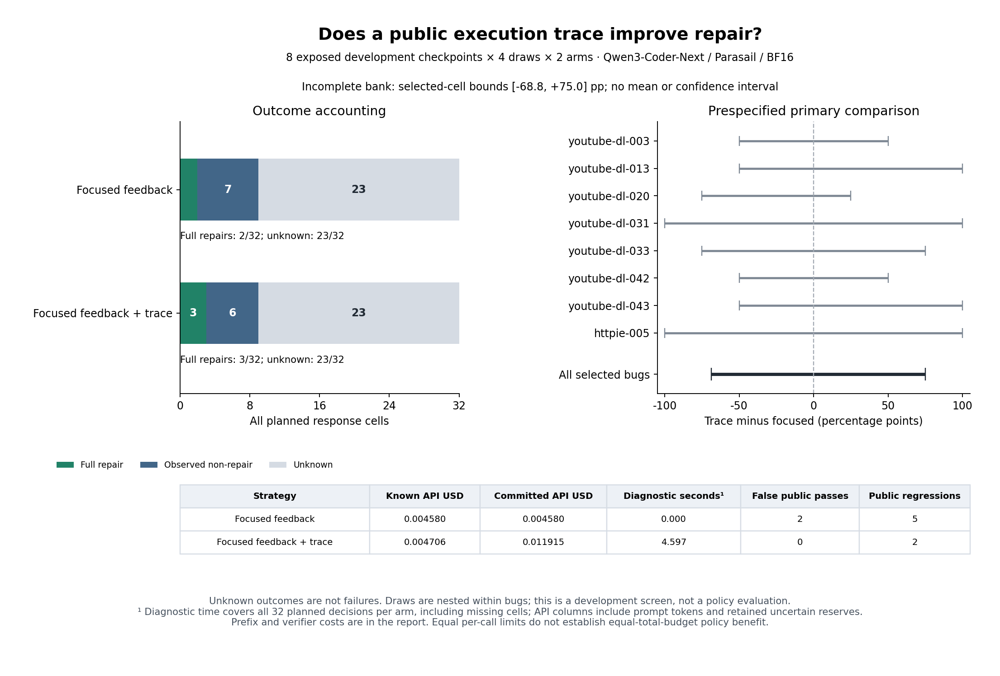

# Matched Qwen public-trace study: interrupted, inconclusive

The new study received **18 of 64 planned responses**, nine per arm, before a
connection `TimeoutError`. The nineteenth request has unknown outcome/billing;
its full $0.00720896 reservation remains. Forty-five requests were never admitted.
No request is retried and this study has no resumption or successor.

| Arm | Received / planned | Full repairs | Public false acceptance | Public-score regressions | Unknown |
| --- | ---: | ---: | ---: | ---: | ---: |
| Focused public feedback | 9 / 32 | 2 | 2 | 5 | 23 |
| Identical feedback + public trace | 9 / 32 | 3 | 0 | 2 | 23 |

These counts do **not** demonstrate a trace benefit, its absence, or a safe
selector. The fixed primary contrast retains all planned cells: its finite
selected-cell bounds are **−68.75 to +75.00 percentage points**. These are not
confidence intervals. The mean and descriptive bootstrap are null and the
engineering gate is inconclusive, as prespecified for an incomplete bank.
No complete-case or historical-control substitute is used. Seven eligible bugs
come from youtube-dl; no outcome was collected for two of the eight eligible
checkpoints. Repeated draws are not independent bugs or untouched evaluation.

All twelve source candidates remain in [analysis.json](analysis.json), including
the four unchanged public passes and their previously documented evaluator
failures/specification ambiguity. The first matched requests were genuinely new;
the historical solver control was used only for qualification. No interim
outcome analysis or source change occurred while the collector was active.



## Accounting and reproduction

Known new API charges: **$0.00928640**. Including the one new unresolved reserve,
study commitment is **$0.01649536 / $0.47**. Cumulative repair commitment is
**$0.08592275 / $0.60**, carrying $0.06942739 exactly once, including eight older
uncertain requests. There are now nine historical/current unresolved calls.
No account/key rotation, generation lookup, fallback or retry was performed.
The saved error has no HTTP status and does not establish a rate limit or its
cause; do not reinterpret it as one of the prior HTTP 429 interruptions.

The report preserves actual charges, public/evaluator verification timing,
source prefix and local diagnostic costs separately. The diagnostic seconds
and counterfactual prefix totals describe **all 32 planned deployments per arm**,
including missing cells; they are not costs of 32 observed responses. Prefixes
are not billed to this research campaign again. A one-call comparison with
matched per-call limits is not an equal-total-budget policy comparison.
Concurrent offline qualification ran on this host; these timing records are
not a controlled deployment-latency comparison.

The [independent sandbox replay](reverification.json) reproduces the full
analysis and Markdown exactly: **36 evaluation records, 34 distinct artifact/suite
inputs, zero discrepancies**. All twelve original public diagnostic projections
also reexecute identically. Eighteen received artifacts remain in the evidence;
the uncertain response is not invented or scored as a failure.

Frozen source: `c6ee8ce670a27273bc3baf33b9260301687d2915`.
Freeze: `dab818d7fe4b80b167d3fbac643b7e0166a5a3c2fb5b0ded19d514051c02ad26`.
Evidence archive SHA-256:
`3af83eea545078a008fa83527b758c73f42990ae0b6a14b993c87a29dcfcde06`.
Read the [prospective protocol](../../QWEN-INFORMATION-PROTOCOL.md),
[generated report](REPORT.md) and [hash manifest](evidence-manifest.json).
The archive includes inert frozen source snapshots and all receipts/requests.

From the repository root, after verifying archive/member hashes and extracting
into a fresh directory:

```bash
uv run python scripts/report_repair_information_study.py \
  --input <extracted>/collection --output <fresh-report-directory>
uv run python scripts/verify_repair_contract_evidence.py \
  --input experiments/python-repair/checkpoint-environment/results/information-qwen-stopped-20261026 \
  --output <fresh-reverification.json>
uv run python scripts/plot_repair_qwen_information.py \
  --input experiments/python-repair/checkpoint-environment/results/information-qwen-stopped-20261026/analysis.json \
  --output <fresh-figure-directory>
```

The original goal remains open. Repair compatibility is established on inspected
development cases; information value, equal-total-budget advantage and a
prospective selector beating the best fixed policy on untouched bugs remain
unestablished. Resolve collection reliability and prospectively declare further
research before more calls. Do not fit a selector to these sparse differences.
