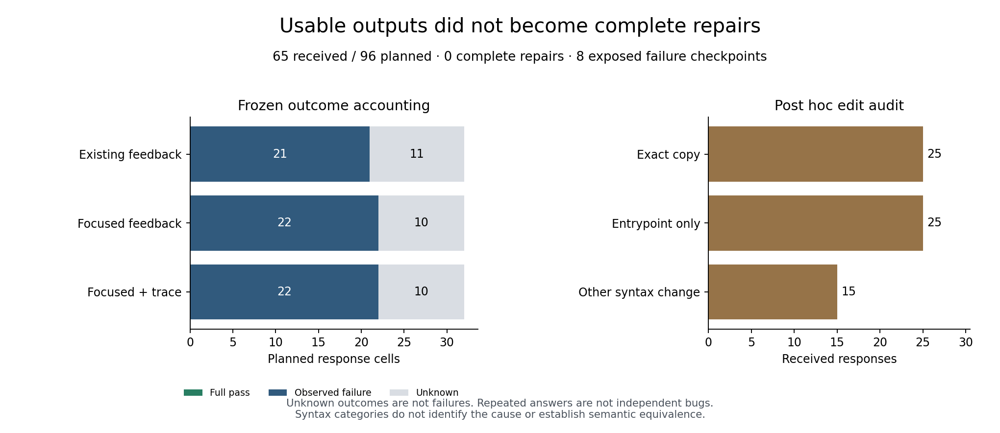

# Public diagnostics did not produce a complete repair in the observed bank

The [frozen three-arm study](../../INFORMATION-PROTOCOL.md) stopped with **65/96
responses** after a second HTTP 429. All 65 responses produce usable artifacts,
but none pass all public tests, and none pass the combined public/evaluator suites.
This is incomplete development evidence, not proof that diagnostics cannot help.
The [original report](REPORT.md) and [analysis](analysis.json) retain every planned
cell, including 31 unknown outcomes: two uncertain admissions and 29 requests
never admitted. No request was repeated; no further successor is enabled.

| Condition | Received / planned | Complete repairs | Unknown |
| --- | ---: | ---: | ---: |
| Existing public feedback | 21 / 32 | 0 | 11 |
| Same facts, focused on the first public failure | 22 / 32 | 0 | 10 |
| Focused feedback plus candidate execution trace | 22 / 32 | 0 | 10 |

The primary trace-minus-focused **finite selected-cell bounds are −31.25 to
+31.25 percentage points**. These bounds describe missingness, not sampling
uncertainty or a confidence interval. The original complete-bank screening rule
remains inconclusive; its treatment mean and bootstrap fields remain null.
There is no basis here for training an acquisition selector, estimating a scaling
law, or asserting a population-level null effect.

## What the saved edits reveal

A separately labeled [post hoc syntax audit](stagnation-audit.json) compares each
response with the files actually supplied in that request:

- **25/65** copy those files byte for byte.
- **25/65** change syntax only inside the declared entrypoint; everything outside
  that function has the same syntax tree, ignoring comments and locations.
- **15/65** change syntax elsewhere. Across all responses there are 30 distinct
  file contents, four public-score improvements on one bug, and one regression.

Changing the entrypoint can change behavior, so this is not a claim that 50
responses are semantically identical. It does show that valid formatting is
insufficient, and that many responses preserve the internal implementation.
For example, all five received answers for `youtube-dl-043` leave the faulty URL
matching logic unchanged while modifying its wrapper. Even explicit public
input/expected/observed feedback does not produce a complete fix in this bank.

The supplied files include a provenance comment saying upstream definitions are
unchanged. It is possible that this cue, the JSON rewrite contract, or the current
patch encourages preservation; limited solver ability is another explanation.
**The present data do not causally identify any of these explanations.** A small,
separately frozen prompt-interpretation control must precede further claims about
information deficiency. See the [next diagnostic design](../../STAGNATION-CONTROL-DESIGN.md).
Historical prompts, tests, scores and source files are unchanged.



Figure generated by `scripts/plot_repair_information.py`. It describes eight
exposed checkpoints, not 65 independent bugs. Four other original source
candidates passed public tests and were retained without intervention; this
experiment cannot address their invisible failures or specification ambiguity.

## Provenance, cost and reproduction

The first admission at source `7fa946f` remained uncertain. The only successor
at source `8f784e9` admitted 66 of its 95 permitted requests and received 65
responses before stopping. Both inert source versions, the parent records,
provider error, original requests, receipts, reservations and candidate objects
are included in [evidence.zip](evidence.zip), with [member hashes](evidence-manifest.json).
Archive SHA-256: `f6e6cad5035268a5015fa4db35943f67201e72480020d0efb3d6b2221486c0fe`.

Known new charges are **$0.01191392**; two uncertain calls retain **$0.00655360**.
The study commitment is **$0.01846752 / $0.34**, and the cumulative repair-campaign
commitment is **$0.04058467 / $0.60**, including seven historical/current unresolved
calls. Counterfactual prefix charges and local diagnostic/verification runtime
remain separate in the analysis. Equal call limits do not mean equal spending.
The new 429 contains no Retry-After or identified rate-limit source; neither
exhausted credit nor the uncertain request's billing outcome can be inferred.

From the repository root, use fresh output paths:

```bash
.venv/bin/python scripts/verify_repair_contract_evidence.py \
  --input experiments/python-repair/checkpoint-environment/results/information-stopped-20261026 \
  --output runs/information-stopped-replay.json

.venv/bin/python scripts/audit_repair_stagnation.py \
  --input experiments/python-repair/checkpoint-environment/results/information-stopped-20261026 \
  --output runs/information-stagnation-replay.json
```

[Independent sandbox replay](reverification.json) reproduces the complete
analysis and Markdown and all public diagnostic projections. It checks 130 saved
evaluation records over 60 distinct artifact/suite inputs, with no discrepancy.
The post hoc audit hashes the archive and every member and does not execute code.
Its counts can be reproduced without provider credentials.
