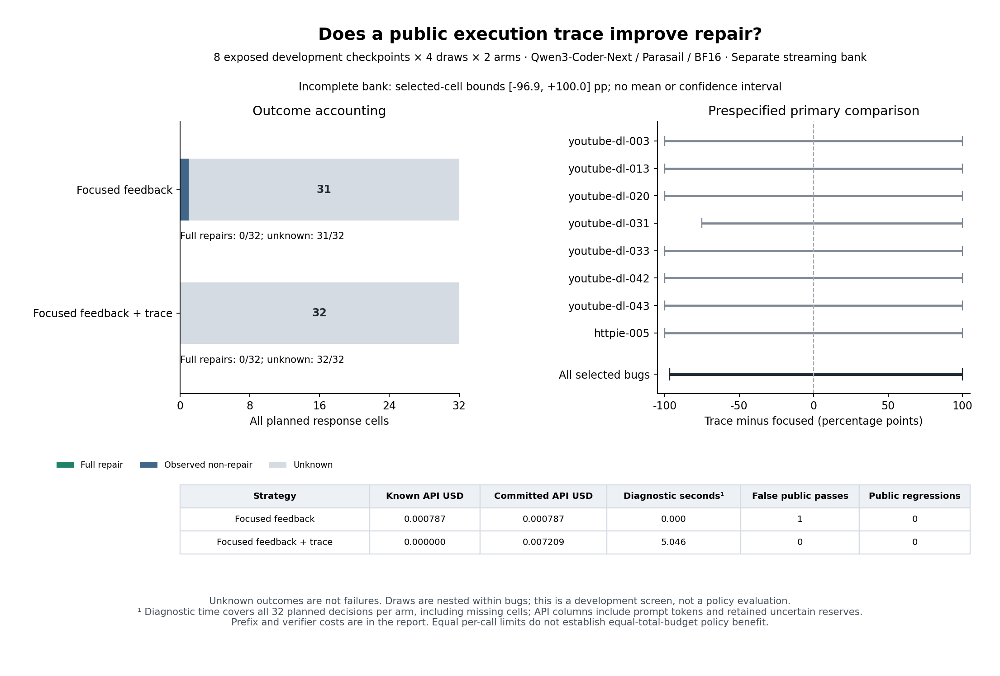

# Separate streaming trace calibration: interrupted, inconclusive

The distinct 64-request development study received **one complete response**.
The second admitted request timed out during streaming, without final usage or
DONE. The remaining **62 requests were never admitted**. All 64 selected cells
and all twelve original source candidates remain in the analysis. The process
exited with status 1; no retry, resumption, replacement or successor is allowed.

| Arm | Received / planned | Full repairs | Public false acceptance | Regressions | Missing |
| --- | ---: | ---: | ---: | ---: | ---: |
| Focused public feedback | 1 / 32 | 0 | 1 | 0 | 31 |
| Identical feedback + public trace | 0 / 32 | 0 | 0 | 0 | 32 |

The one received candidate passed public tests but failed the evaluator. This
retained false acceptance is not a trace comparison. The uncertain request was
in the trace arm, and missingness is not assumed random. The primary trace-minus-
focused contrast has selected-cell bounds **−96.875 to +100 percentage points**;
these are not confidence intervals. Its mean/bootstrap remain null and the fixed
screen inconclusive. Neither trace benefit nor absence of benefit follows.

The sources are eight previously exposed public failures (seven youtube-dl,
one httpie), with four planned draws per arm. Four other source candidates passed
public tests and remain in provenance. These are development checkpoints, not
new bugs or a holdout. The complete request schedule was frozen before calls;
paired bodies differed only in the public runtime diagnostic. No intermediate
treatment results were inspected. Prior studies remain separate and no selector
was trained.



## What failed

The saved exception is `TimeoutError` during `reading_stream`, at **182.59655 s**
of exchange time, with no HTTP status or structured provider error. First bytes
arrived after 1.168395 s; 143 chunks, 39,830 wire bytes and 482 content characters
were received. There was no finish reason, final usage or DONE. Partial text was
not persisted or scored. The wire cap was 8,388,608 bytes and was not approached;
there is no recorded parser error. This is distinct from the earlier client
1 MiB envelope failure. It does not identify a network, intermediary or provider
cause, and does not establish that a longer timeout would work.

The first response had a complete SSE receipt: 222,607 wire bytes, 799 chunks
and 2,293 content characters, in 12.603 s. A successful first exchange and a
separate engineering size check did not ensure completion of this scientific
bank. Raw SSE bytes are not archived; metric/hash checks cannot replay the
original wire stream byte for byte.

## Accounting and independent reproduction

Known new charge: **$0.00078680**. Retained uncertain reserve: **$0.00720896**.
Study commitment: **$0.00799576 / $0.47**. Carrying $0.11785551 exactly once gives
**$0.12585127 / $0.60** cumulative repair commitment, including **13 unresolved
requests** across closed studies. No paid receipt lacks an evaluated outcome.
Unspent allocation does not permit completing or repeating this closed schedule.

The [full report](REPORT.md) and [analysis](analysis.json) retain costs and
missingness for every planned decision. Each arm has $0.00439680 counterfactual
source-prefix cost, not a new bill. The trace strategy projects 64 local diagnostic
executions and 5.046 s over its 32 planned decisions; original public verification
projects 14.956 s per arm. Actual response verification was 0.959 s for the one
observed candidate. Local execution time, deployment projections and API spending
are separate resources. This was not an equal-total-budget policy experiment.

The [independent sandbox replay](reverification.json) reproduces analysis and
Markdown exactly, checks **both saved evaluation records / two artifact-suite
inputs**, and reproduces all twelve public diagnostic projections with zero
discrepancies. The sandbox denies network/filesystem access and receives no
credentials. The [figure audit](figure-audit.json) records source/image hashes
and visual inspection. The archive includes inert frozen source snapshots,
prepared/admitted requests, complete receipt, interrupted-stream metrics and
all reserves. No model calls occur during replay.

Source: `b6bf9826eafce433d0c1203aba2f33f5f9dd4f19`.
Freeze: `a1f39ffd9ad6e782e34aa530e1a44869fa2172199c857a685025adb483bed632`.
Evidence SHA-256: `265123653e998438eabf9652406c58393d2daec590fd4aee3276e0282bd018ff`.
See the [prospective protocol](../../STREAM-INFORMATION-PROTOCOL.md) and
[hash manifest](evidence-manifest.json). From the repository root, verify the
archive/member hashes, extract into a fresh directory, then run:

```bash
uv run python scripts/report_repair_information_study.py \
  --input <extracted>/collection --output <fresh-report-directory>
uv run python scripts/verify_repair_contract_evidence.py \
  --input experiments/python-repair/checkpoint-environment/results/information-stream-stopped-20261026 \
  --output <fresh-reverification.json>
uv run python scripts/plot_repair_qwen_information.py \
  --input experiments/python-repair/checkpoint-environment/results/information-stream-stopped-20261026/analysis.json \
  --output <fresh-figure-directory>
```

## Consequence for the research goal

The information intervention has not been adequately measured. A first-error
stop combined with a complete-bank gate makes even one infrastructure failure
sufficient to prevent the screen. Changing that acquisition design must be
prospective and separate; it cannot rescue this bank. Future work must preserve
uncertain costs and outcomes, keep all selected cells, and distinguish scientific
uncertainty from operational failure. No selector should be fit from this bank.
Repeatable diagnostic benefit and superiority over fixed policies on untouched
bugs at equal total resources remain unproved.
