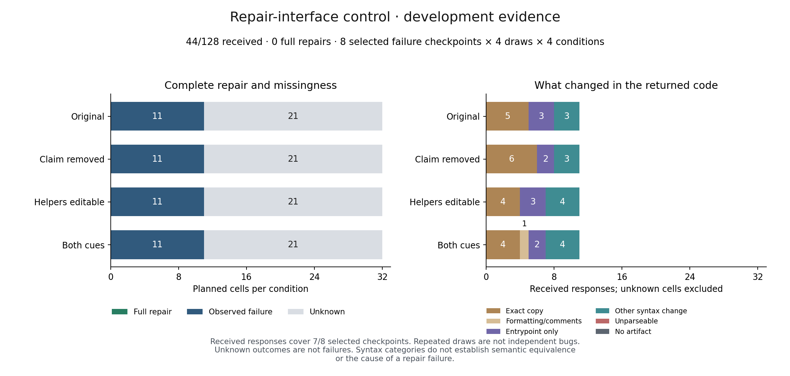

# Interface control: no complete repair among 44 received answers

The [prospective factorial control](../../INTERFACE-PROTOCOL.md) received **44 of
128 planned responses** before HTTP 429 stopped its only permitted collector.
Every response is a usable Python artifact; none passes the full public suite,
and none passes the combined public/evaluator suites. Removing the provenance
claim and explicitly allowing helper edits did not produce a complete repair
in these observations. This does not establish a zero population effect.

| Condition | Received / planned | Full repairs | Exact copies | Entrypoint-only edits | Other syntax edits |
| --- | ---: | ---: | ---: | ---: | ---: |
| Original instruction and comment | 11 / 32 | 0 | 5 | 3 | 3 |
| Preservation claim removed | 11 / 32 | 0 | 6 | 2 | 3 |
| Helpers explicitly editable | 11 / 32 | 0 | 4 | 3 | 4 |
| Both changes | 11 / 32 | 0 | 4 | 2 | 4 |

The combined condition also has one formatting/comment-only edit. Overall there
are 19 exact copies, ten entrypoint-only syntax edits, one formatting-only edit
and fourteen other syntax edits. One response in `claim_removed` improves the
public-test fraction without solving its task. There are no observed regressions
or public false acceptances. Syntax categories do not prove semantic equivalence.

The received answers cover **seven of eight selected checkpoints**, in eleven
completed task/draw blocks. Each block contains all four conditions, but bugs
have unequal numbers of received draws; `youtube-dl-043` has no response. The four
public-pass source candidates remain without intervention. Neither 44 answers
nor eleven blocks are 44 or eleven independent bugs.



The [frozen report](REPORT.md) and [analysis](analysis.json) retain **84 unknown
cells**: one uncertain admission and 83 requests never admitted. The primary
`both` minus `original` selected-cell bounds are **−65.625 to +65.625 percentage
points**. These are finite missingness bounds, not confidence intervals. The
complete-bank mean and bootstrap fields remain null, and the original gate is
inconclusive. Secondary factorial effects cannot replace the primary contrast.
No selector is trained, and no interface configuration is selected as validated.

## What changes in the research decision

The two tested instruction changes have not supplied successful alternatives
for a selector. The evidence does not justify treating the provenance comment
as the sole cause, declaring a general model-size threshold, or fitting a
repair/acquisition policy. A separate solver-compatibility positive control on
the same tasks and verification contract is a relevant next calibration step;
it would need its own model/provider review, protocol and allocation. Changes
of model and serving endpoint would not isolate parameter count.

There is also an operational limitation: 30-second pacing did not prevent a
429 at the pinned endpoint. Its bounded error record contains code 429 but no
Retry-After or identified rate-limit source. Do not infer exhausted credit,
the cause of the provider limit, or that it has reset. No retry, resumption,
fallback, key rotation or successor is enabled. Historical missing requests and
scores remain untouched; do not pool the two interrupted studies as independent
evidence or present this development bank as held-out evaluation.

## Cost, provenance and independent replay

Collection used commit `10469428f1feca1e5ad5a720c3199e38c9f35ad4`, which passed
[CI](https://github.com/EmaRimoldi/how-to-pick-a-model/actions/runs/40338732174), and
freeze `470148e1b0fcc29e363cd337980cb638e0e52ed177743454267397f3b5f52efe`.
All exact requests, receipts, observations, source records, unresolved reservation
and inert frozen implementation are preserved in [evidence.zip](evidence.zip).
The [manifest](evidence-manifest.json) verifies archive SHA-256
`cecb09caa99ce851d1ca1df1f5e6bf719ea43fcdd166f5428af52da30dc0eb59`.

Known study charges are **$0.00740592**, with **$0.00327680** reserved for the
uncertain call. Study commitment is **$0.01068272 / $0.43**; cumulative repair
commitment is **$0.05126739 / $0.60**, including eight historical/current unknown
calls. Prefix costs and local verification runtime remain separate in the
analysis; equal caps are not equal realized spend or equal total policy cost.

[Independent sandbox replay](reverification.json) exactly reproduces the complete
analysis and Markdown, and checks **88 evaluation records across 58 distinct
artifact/suite inputs**, with no discrepancy. From the repository root, use fresh
output paths:

```bash
.venv/bin/python scripts/verify_repair_contract_evidence.py \
  --input experiments/python-repair/checkpoint-environment/results/interface-stopped-20261026 \
  --output runs/interface-stopped-replay.json

.venv/bin/python scripts/plot_repair_interface.py \
  --input experiments/python-repair/checkpoint-environment/results/interface-stopped-20261026/analysis.json \
  --output runs/interface-stopped-figure
```

The published figure uses the terminal analysis and was visually checked. The
earlier layout test used explicitly marked synthetic data and is not evidence.
