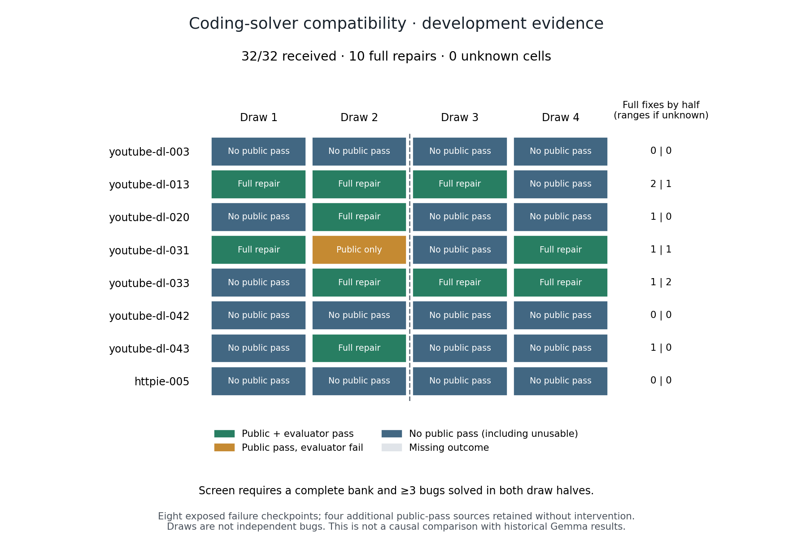

# Qwen coding-solver compatibility: complete development control

**The prespecified compatibility screen passes.** Qwen3-Coder-Next on
Parasail/BF16 produced 10 complete public-plus-evaluator repairs in 32 attempts
on eight previously exposed failed checkpoints. Five bugs have at least one
repair; three have a repair in each of the two draw halves. This permits a
separately frozen intervention calibration. It does **not** permit selector
training or establish a benefit from diagnostics.



The [protocol](../../SOLVER-PROTOCOL.md) fixed the tasks, original public messages,
JSON contract, provider, four draws per checkpoint and screen before collection.
The bank is complete: no new missing response or uncertain charge. All twelve
source candidates remain in provenance; four public passes received no repair.
The source freeze is `418f17ed245296b0eb0929f137257be344bf25a9` and the freeze ID is
`85b3cadebf93e16622c89e04a618fbadef2a777f84389dc10953c815b5b847d9`.

## Findings and interpretation

| Outcome | Result |
| --- | ---: |
| Complete repairs / all planned draws | 10 / 32 (31.25%) |
| Descriptive 95% bug-bootstrap interval | 12.5%–53.125% |
| Bugs solved in both draw halves | 3 / 8 |
| Usable Python artifacts | 26 / 32 |
| Public passes | 11 / 32 |
| Public pass but evaluator failure | 1 / 32 |
| Public-score improvements / regressions | 15 / 11 |
| Missing outcomes | 0 |

The repeated successes are youtube-dl-013, -031 and -033. Bugs -020 and -043
have one success each. Bug -003, -042 and httpie-005 have none. Every attempt is
retained; the six unusable outputs count as unsuccessful attempts, not exclusions.
Regressions compare the public-case fraction with the same source checkpoint;
that count includes unusable outputs assigned zero public progress.

This shows that the original checkpoint interface admits repeatable repairs
with this solver configuration. It does not isolate why historical Gemma
attempts failed: model, training, provider, precision, seeds and time differ.
There is no concurrent causal model comparison or scaling-law evidence. Seven
of the eight eligible bugs are adapted from youtube-dl, and all are development
exposed. Replicate draws are not independent bugs. The wide bootstrap interval
describes these eight clusters, not an untouched task population.

The next scientific question is whether **new public execution information**
improves this solver enough to repay its acquisition and prompt costs. A new
study must use fresh requests and compare diagnostic-first with a matched
direct-repair control; it cannot reuse these outcomes as its concurrent arm.
Only repeated intervention benefit would justify a prospective acquisition
selector, followed by evaluation on separate bugs/projects against the best
fixed policy. No further model calls are enabled by this result.

## Acceptance coverage remains a separate problem

The [closed-source trigger audit](trigger-coverage-audit.json), performed before
reading this control's outcomes, independently reexecutes 24 source evaluations.
Of four accepted public-pass sources, one passes the evaluator and three do not.
One of the latter involves the already documented timestamp ambiguity; the other
two violate explicit preservation requirements. Historical scores stay unchanged.

Even perfect recovery of all eight triggered failures would yield at most 9/12
full passes **if public-pass sources are accepted unchanged under the frozen
criterion**. This is a counterfactual ceiling under those assumptions, not an
observed policy result. Conditional repair success and end-to-end acceptance
coverage must be reported separately. Any revised task or verifier needs its
own version; no hidden case may silently become public calibration feedback.

## Costs and reproducibility

Known new API charges total **$0.01816000**, below the separate $0.24 study cap.
Cumulative repair commitment is **$0.06942739 / $0.60**, including the unchanged
eight historical uncertain reservations. This study introduces none. All 32
requests, response receipts and ledger entries reconcile.

The report additionally records $0.00439680 in counterfactual prefix charges
across the 32 deployments; these are not billed again to the research ledger.
Source verification, response verification and provider latency are reported
separately. The one-minute admission spacing is an operational precaution, not
an algorithmic latency claim. This control is not an equal-budget policy test.

[Independent replay](reverification.json) reproduces the full analysis and
Markdown report exactly and reexecutes 62 saved public/evaluator records from
60 distinct artifact/suite inputs with zero discrepancies. The absent artifact
has no executable verification record; it remains an unsuccessful observed draw.
The evidence archive SHA-256 is
`b349586449d6b25b04e333dfc442b7e54f6c660ebf04a8baefc17c093af5474e`.
Frozen sources are inert text; model outputs are data.

```bash
.venv/bin/python scripts/verify_repair_contract_evidence.py \
  --input experiments/python-repair/checkpoint-environment/results/solver-qwen-20261026 \
  --output runs/solver-qwen-replay.json

.venv/bin/python scripts/plot_repair_solver.py \
  --input experiments/python-repair/checkpoint-environment/results/solver-qwen-20261026/analysis.json \
  --output runs/solver-qwen-figure

.venv/bin/python scripts/audit_repair_trigger_coverage.py \
  --output runs/solver-source-trigger-audit.json
```

Use fresh output paths. These commands make no model calls. The trigger audit's
timestamps and measured runtimes vary; its classifications and ceiling must
reproduce. The figure uses the audited analysis and has been visually checked.

The [literature follow-up](literature-followup.json) and
[latest CTA paper/code review](cta-source-review.json) were conducted while the
collector ran without reading outcomes or changing its protocol. See the
[updated claim boundaries](../../../../../docs/recovery-related-work.md).
