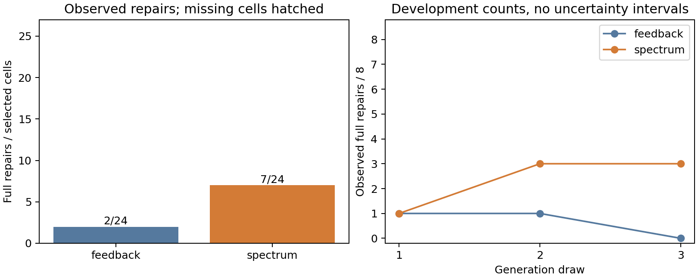

# Public-coverage repair screen: complete, criterion not met

The diagnostic arm repairs **7/24** selected cells versus **2/24** with feedback
alone, a descriptive difference of five repairs (+20.83 percentage points).
All **48/48** responses are received, settled and evaluated; no new HTTP or
uncertain-charge failure occurred. Three bugs have at least two diagnostic-arm
successes, but the net differences by draw are **0, +2, +3**. The prespecified
requirement was a strictly positive difference in every draw, so the development
screen **fails**. This is not an inconclusive incomplete bank and the criterion
is not relaxed after seeing the aggregate improvement. No selector is trained.

The three successful diagnostic bugs are youtube-dl-013 (2/3), -033 (2/3) and
-043 (3/3). The other five fail in every draw in both arms. These are descriptive
case-level results on previously exposed development data, not a criterion for
dropping difficult tasks or selecting a favorable follow-up population.

| Fixed arm | Full repairs | By draw | Public false acceptances | Outputs regressing a public case | API cost |
| --- | ---: | --- | ---: | ---: | ---: |
| Feedback | 2/24 | 1, 1, 0 | 3 | 7 | $0.01420604 |
| Feedback + spectrum | 7/24 | 1, 3, 3 | 0 | 7 | $0.01267196 |

Each arm has one invalid output. A paired comparison has six diagnostic-only
successes and one feedback-only success. Seven outputs in each arm regress
previously passing public cases, totaling 23 case regressions per arm. Thus the
larger success count does not establish a general reduction in regressions.
All details, including invalid outputs, are retained in [analysis.json](analysis.json).

The diagnostic arm used more input tokens (38,973 versus 21,357) and fewer output
tokens (11,218 versus 14,894), producing a smaller observed API bill in this
sample. It also requires twelve extra local executions per action. These counts
do not establish a cost advantage at equal total resources, and local overhead
whose duration was not recorded during the implementation correction remains
missing, not zero. Total study cost is **$0.02687800**; cumulative commitment is
**$0.25463059 / $0.60**, including fourteen unchanged historical uncertain reserves.



## What this establishes

The diagnostic arm produced more full repairs on some failed checkpoints in
this small sample. It has not met our repeatability criterion. Neither the
isolated merit of Ochiai, unseen-task performance nor an adaptive policy benefit
has been demonstrated. Seven of eight bugs come from one project. There is no
length-matched placebo, no causal comparison with earlier trace studies and no
claim that the historical 429's cause is resolved.

The next justified work is an explicitly post hoc failure audit on these already
exposed cases: distinguish ignored diagnostic cues, incorrect edits and public
acceptance gaps. That may inform a new intervention and separately frozen
validation on independent data. Do not rerun this bank until its criterion passes,
choose only the successful bugs, or train a selector on this result.

## Protocol, deviation and verification

The [protocol](../../SPECTRUM-PROTOCOL.md) fixed selection, 48 requests, prompts,
three draws, arm order and the screen before dispatch. The
[implementation correction](../../SPECTRUM-IMPLEMENTATION-CORRECTION.md) records
the initial local evaluator accessor defect, offline recovery of one fully
settled response and dispatch of only the 47 never-admitted IDs. Original and
corrected manifests, complete parent, receipts and exact ledgers are retained.
No request was repeated, no new budget was introduced and no interim arm summary
was used to change the study.

The terminal auditor verified all 48 prompt bodies, unique generation receipts,
charges, parent imports and recorded outputs. Independent native sandbox replay
re-executed all **92** public/evaluator suites for the 46 valid artifacts with no
discrepancy. Invalid outputs are scored as failures without fabricated execution.
The figure was visually checked. Sources are archived inertly in `evidence.zip`;
checksums for the original publication are in [manifest.json](manifest.json).

From the repository root, no credentials or model calls:

```bash
uv run python experiments/python-repair/checkpoint-environment/results/spectrum-screen-20261030/reproduce.py
```

Add `--sandbox` to re-execute all suites on a supported macOS installation. The
default verifies archive hashes, exact requests/receipts, scoring and the rendered
report without executing candidate code. The [frozen report](REPORT.md) remains
the unedited output of the prespecified reporter; this README adds interpretation.
